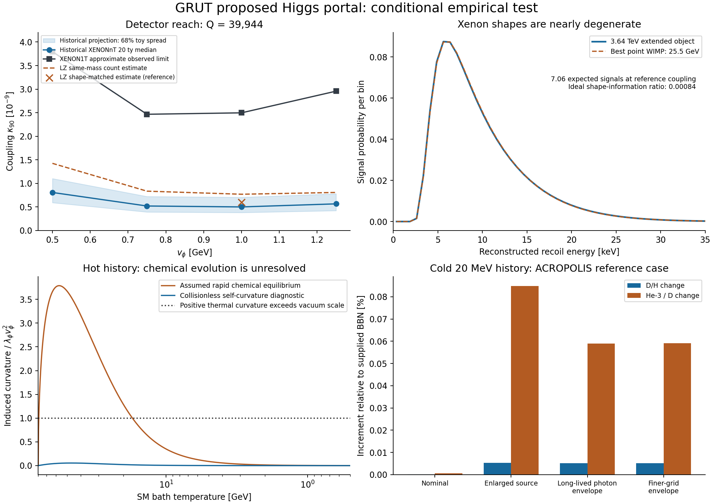

# Proposed Higgs portal: detector and cosmic-history test

22 October 2026 (America/Chicago). Codex / AInstein; one author.
Parent: `fa3bc97b52f44bdd625da8b40fdc7015837517a7`.

**Result:** the proposed portal can produce an experimentally relevant
recoil rate without large additional particle production in a supplied
cold history. This calculation does **not** establish an allowed,
distinguishable dark-matter model. Two LZ approximations disagree enough
to matter, and the reference object's xenon spectrum almost exactly
imitates a much lighter ordinary WIMP. Its formation and today's vacuum
density remain supplied inputs.

## What is being tested

The working construction is an effective field theory built on ordinary
quantum mechanics, the Standard Model and Einstein gravity. Its extra
fields are a real order parameter phi, a charged complex field X and a
neutral probe D. X charge can stabilize extended objects whose binding,
depletion of phi and probe response come from the same action. None of
these extra fields has observational evidence here.

The parent proposed a conventional additional interaction

\[
\Delta U=\frac{\kappa}{2}(\phi^2-v_\phi^2)
(H^\dagger H-v_H^2/2).
\]

This packet tests that proposal at three existing classical charges and
four explicitly hypothetical scales, v_phi = 0.5, 0.75, 1, 1.25 GeV. It
does not replace the original high-scale, zero-portal benchmark. The q
vacuum, kinetic-pole and reheating branches have not been identified with
these fields or combined into a single derived cosmology. Standard
Higgs-portal/soliton methods and experimental tools are credited in
[SOURCES.md](SOURCES.md); literature novelty is not asserted.

The portal couples to exactly the already-solved depletion operator:

\[
g_{Qh}(0)=-\frac{\kappa v_H E_Q}{2\lambda_\phi v_\phi^2},
\quad
F_Q(q)=\frac{\int (v_\phi^2-\phi_Q^2)e^{i\mathbf q\cdot\mathbf x}d^3x}
{\int (v_\phi^2-\phi_Q^2)d^3x}.
\]

Its rate, production and mediator decay therefore use a common kappa.
This is a specified link between calculations; it does not determine
kappa, the scale, charge distribution or the dark-matter abundance.

## Detector result and the important degeneracy

Folded natural-xenon recoil spectra through the official migration
matrices, including efficiency and resolution. Used the recommended
XENON1T approximate observed likelihood and all 1000 supplied background
toys of the historical XENONnT 20 tonne-year projection. The projection is
a dated experimental scenario, not observed data or an updated 2026
forecast. An exclusion sensitivity does not guarantee discovery.

Reference: Q = 39944, v_phi = 1 GeV, mass = 3639.24 GeV,
energy R90 = 10.07 fm; supplied local all-DM density 0.3 GeV/cm^3 and
the fixed halo/nuclear inputs in [MATHEMATICS.md](MATHEMATICS.md).

| Quantity | Calculated result | Interpretation |
|---|---:|---|
| XENON1T kappa_90 | 2.4973e-9 | Official approximate observed likelihood |
| XENONnT 20 ty kappa_90 median | 5.0071e-10 | Historical background-only projection |
| Projection central 68% toy range | 3.8159e-10 to 7.0527e-10 | Toy variation, not parameter error |
| LZ same-object-mass count estimate | 7.7003e-10 | Efficiency reweighting of published WIMP limit |
| LZ alternative shape-matched estimate | 5.9950e-10 | Another approximation, no full LZ likelihood |

The reference coupling 6.2093e-10 was selected as the geometric midpoint
of the first projection and same-mass LZ estimate. It was retained after
the stronger alternative estimate was calculated. It would give 7.063
accepted signals in the historical 20 ty response, but it lies slightly
above the alternative LZ estimate. **Do not label this reference allowed.**
The apparent median reach interval approximately 5.0e-10 to 6.0e-10
is narrower than the unquantified LZ spectral/statistical systematics.
There is no established surviving interval from this calculation.

The same reference spectrum is closely reproduced by a point WIMP of
mass 25.481 GeV and nucleon cross section 2.8284e-48 cm^2 when its
normalization is fitted in the same xenon response. Their normalized
reconstructed-bin total variation is 0.003874 and KL divergence is
5.923e-5 per signal. At 7.063 signals the ideal, signal-only twice-mean
log likelihood ratio is 0.000837. Even the heuristic value 9 would
require about 76000 pure signals in these fixed shapes. This is an
information diagnostic, **not** a confidence calculation with real
backgrounds, nuisance parameters or a WIMP discovery claim.

Thus an extended-object form factor alone is not a distinguishing
prediction at this exposure. A full LZ recast and a calculation with a
second nuclear target are more useful next steps than optimizing a
xenon event count. Across a fixed object family the common profile and
portal constrain both targets; that relation must be tested against
alternative WIMP masses, halo uncertainties and charge mixtures.

## Cold history: little additional production, conditional preparation

Specified a bath whose **maximum temperature after the supplied
preparation** is 20 MeV, the +v_phi phase and an initial charged-object
population calibrated to the dark-matter abundance. A final reheating
temperature of 20 MeV with a hotter earlier bath is a different history.
Low-reheating literature is context, not a derivation of this preparation.

Included scalar inverse decays and visible annihilation through the
same portal. Integrated their energy transfer and conservatively
allowed every injected unit of energy to survive immediately as stable
pressureless matter. At the reference coupling:

| Calculation | Nominal response | Enlarged source envelope |
|---|---:|---:|
| Added energy / supplied dark-matter energy, upper estimate | 5.20e-10 | 3.07e-8 |
| Scalar lifetime | 1.24e11 s | 2.18e9 s |
| Included coherent elastic collision optical depth, upper estimate | 5.94e-7 | 1.32e-4 |

The envelopes use photon scalar-current coefficients 10 and 100; the
second also multiplies the leading chiral hadronic width by 1000 and
uses Gamma_SM(m) = m above 1 GeV. These deliberately generous choices
are not exact QCD calculations or parameters inferred from data. Fixed
g_* = g_*s = 10.75 and Maxwell-Boltzmann distributions approximate the
source era. The computed invariant-mass tail from 2 to 1000 GeV adds
only 7.13e-39 of the reference DM energy under the stated width cap;
still higher masses have stronger exponential suppression. The portal
does not measurably restore the homogeneous phase through the computed
production or visible tadpole in this history.

The collision estimate covers the stated coherent elastic channels,
with form factors and speeds replaced by upper values. It does not
calculate or bound every inelastic object transition. Classical binding
and a small bath correction do not establish a quantum lifetime,
formation mechanism, merger history or total survival probability.

Long lifetimes cannot be assessed by imposing a thermal-abundance
lifetime limit. Ran original **ACROPOLIS 1.3.1** on the deliberately
overestimated scalar population obtained by putting *all* injected
energy into scalar rest mass. The incremental D/H change is 5.00e-7
nominally and 5.36e-5 in the enlarged source case; corresponding He3/D
changes are 5.87e-6 and 8.48e-4. An additional pure-photon, longest-
lifetime envelope gives changes 5.19e-5 and 5.91e-4 on the finer grid.
These are fractions, not percentages. He4 changes are negligible here.

This nuclear calculation concerns the reference case and the supplied
standard BBN background. It is not a new global BBN/CMB fit, a solution
of the standard lithium problem or a scan of all twelve nuclear cases.
It supplies no evidence that these objects actually exist.

## Hot history remains undecided

For a broken-phase SM bath initially at 80 GeV, Higgs decays transfer
energy into the hidden sector with conserved total comoving radiation
energy. If rapid hidden **chemical** equilibrium is imposed, the
reference hidden temperature reaches 3.01 GeV, above the leading
critical temperature 1.55 GeV: its induced curvature ratio peaks at
3.79. In the collisionless production calculation the self-curvature
ratio peaks at 0.0544, below restoration.

Elastic scattering alone does not prove chemical equilibrium. We have
not solved the number-changing reaction network or phase transition.
These different approximations therefore do not establish that the
actual hot history restores the symmetry, creates walls or fails. All
twelve rapid-equilibrium examples exceed the leading restoration
criterion, but that remains a conditional statement.

## What is still required for the working theory

1. **Empirical identification.** Obtain an actual spectral exclusion or
   allowed region and a distinguishing observation, accounting for the
   point-WIMP degeneracy and other particle/astrophysical constraints.
2. **Formation and survival.** Produce the charge population, phase and
   abundance from a stated history; compute the hidden chemical evolution
   if hot, and relevant inelastic/quantum lifetimes in either case.
3. **Vacuum matching.** The radiation/late-universe history here is
   conditional on a supplied calibrated total renormalized vacuum
   density. The old zero-counterterm condition does not select it. This
   portal neither derives its observed value nor joins the separate
   vacuum branches into this matter construction.

The new work turns a signal-size proposal into a reproducible detector
and production test, and exposes a strong observational degeneracy.
That is progress on a particular effective model. It does not complete
GRUT as a theory of reality. Mathematical consistency, calibrated
phenomenology and empirical support remain different statuses.

[Derivations](MATHEMATICS.md) · [results](DETECTOR_RESULTS.json) ·
[history](HISTORY_RESULTS.json) · [shape](SHAPE_RESULTS.json) ·
[nuclear runs](PHOTODISINTEGRATION_RESULTS.json) ·
[verification](VERIFICATION.md) · [reproduction](REPRODUCE.md).
