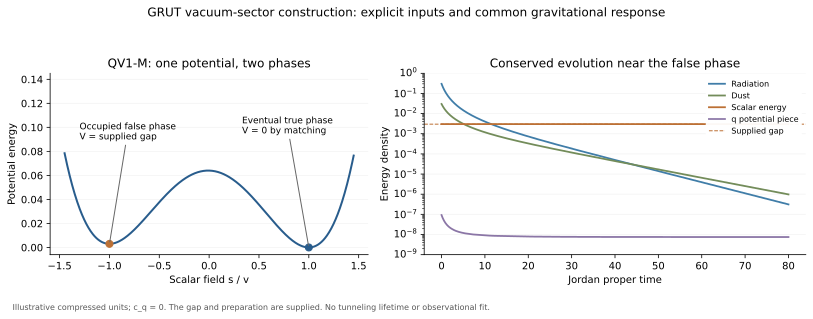

# GRUT working vacuum sector: an explicit effective candidate

21 October 2026. Builder continuation after Claude's stage-1 checkpoint.
This document states the constructed model. REPORT.md gives the results
of all four stage-2 threads; MATHEMATICS.md gives the equations and
derivations. The model is a working hypothesis with supplied inputs.
Its microscopic vacuum selection and empirical identification remain open.

## Physical statement

Use ordinary matter and radiation coupled to one dynamical metric, with
an additional vacuum variable q and a scalar s whose potential has two
local minima. The eventual lower-energy phase is assigned zero total
renormalized vacuum energy by the q-sector state condition. If the
universe occupies the higher phase, its positive energy gap gravitates
and drives accelerated expansion. The q field and geometry respond by
the same equations during matter evolution and a change of phase.

The observed small positive density can be represented consistently in
this construction. Its magnitude is calibrated through the phase gap;
we have not derived that number from closure or ordinary particle data.
This version is called **QV1-M**, to keep it distinct from the symmetric
QV1 example and the separate dynamical-relaxation model.

The q mechanism is borrowed from Klinkhamer--Volovik. The scalar-tensor
response and metastable-vacuum mechanism are known physics. The present
GRUT contribution is this explicit joint specification, worked evolution,
conditional consequences and executable checks. No originality or
empirical-validation claim follows from the naming.

## One action and one state rule

\[
S=\int d^4x\sqrt{-g}\left[
{K(q)R\over2}-\epsilon(q)-{(\nabla s)^2\over2}-V_M(s)
\right]+S_{\rm ordinary}[g,\psi],
\]

\[
V_M(s)={\lambda_s\over4}(s^2-v_s^2)^2+
{\delta\over4}\left[2-3{s\over v_s}+\left({s\over v_s}\right)^3\right].
\]

The four-form realization q=Ftilde/sqrt(-g), F=dA, supplies

\[
\epsilon'(q)-\tfrac12K'(q)R=\mu,\qquad\partial_\nu\mu=0.
\]

The metric and matter equations follow from this action. The final-vacuum
condition P_q selects mu so that the **fully renormalized** total energy
of the eventual true phase is zero. This is an additional state/matching
postulate. It is not enforced by the nondissipative evolution, and it
must include the full vacuum contribution rather than a convenient
tree-level subtraction.

For the worked local branch, K is linear and epsilon quadratic. The
gravitational sector is equivalently M²[R+R²/(6m_q²)]/2 with zero final
q residual. This is a supplied simple branch of the free functions.
It has the usual two tensor polarizations plus one scalar mode where
K'>0 and K>0. In general the scalar branch only needs K' nonzero; the
chosen linear representative uses the positive sign.

## What happens

The two stationary phases have

\[
V_M(-v_s)=\delta,\qquad V_M(+v_s)=0.
\]

For delta>0 and delta<4lambda_s v_s^4/3, both are local minima. The
present false phase is a preparation choice. Its classical late-time
solution has

\[
H^2={\delta\over3M^2},\qquad
{K\over M^2}-1={4\delta\over3M^2m_q^2}.
\]

Thus the same field equations give a positive accelerating phase and a
zero-energy eventual phase. The simulations also include a small
perturbation of the false phase and a preparation above the barrier.
The former returns toward the false minimum in the tested interval;
the latter rolls toward the true phase and decelerates. No quantum
tunneling rate or cosmological lifetime is inferred from that result.

The symmetric-potential calculation separately follows a complete
homogeneous vacuum-energy change, including scalar kinetic energy,
ordinary dust, radiation and the gravitational response. It retains
the failed zero-residual accelerating-universe claim alongside the
successful example with a supplied residual. The field equations
conserve the total local stress tensor and account for expansion work.

The figure uses compressed numerical units. Its masses and field
values are integration controls, not a physically calibrated EFT
benchmark or an electroweak/Planck hierarchy simulation.
The q potential curve shows one term in the metric equation; the same
solution also changes K. It is not an additional fitted dark-energy density.

## Consequences at fixed inputs

One example relation is the tree-level gap/curvature relation

\[
\delta={v_s^2\over3}(m_+^2-m_-^2).
\]

Its inputs and its quartic-potential approximation are explicit.
Loop matching and additional operators can change it. For the physical
illustration below the splitting is far too small to call it an
accessible distinguishing measurement.

Growth, lensing and tensor propagation follow the same K(q). In the
linear unscreened quasi-static regime, the response is

\[
g_{\rm dyn}={M^2\over K}(1+s_k/3),\quad
\eta={1-s_k/3\over1+s_k/3},\quad\Sigma={M^2\over K},\qquad
s_k={k^2/a^2\over k^2/a^2+K/(3K_R)}.
\]

On a homogeneous branch, geometric-optics propagation with source
effects accounted for gives (d_L^GW/d_L^EM)² approximately Sigma(z)/Sigma(0).
Source/detector screening requires its own treatment. These constraints
are shared with the corresponding f(R) model and do not identify GRUT
uniquely. The previous response packet contains their derivation.

## Parameter and state costs

| Quantity | Status |
|---|---|
| M and ordinary matter parameters | Adopted from gravitational and particle physics; not derived here |
| Functions epsilon and K; local mass m_q | Supplied EFT choice; their origin is open |
| Final-vacuum rule P_q and mu | Added state/matching postulate; not formed by this action |
| lambda_s and v_s | Independent scalar-sector inputs; no measured identification |
| delta | Free positive gap; calibrated if set to the observed dark-energy density |
| Occupation of the false phase | Supplied preparation; no inflationary production calculation |
| Dust/radiation densities and perturbation state | Supplied cosmological inputs |

For an explicit **analytic low-curvature illustration**, take v_s=1 TeV,
lambda_s=0.1, m_q=0.1M and delta=2.52e-47 GeV^4. The scalar's zero-bias
mass is about 447 GeV, but its ordinary-matter production coupling has
not been supplied, so this is not a collider prediction. The phase mass
squared splitting is 7.56e-53 GeV². The gap is 2.52e-58 times
lambda_s v_s^4. These numbers display the hierarchy rather than explain it.

If every coupling respects s->-s at delta=0, that limit keeps the phases
degenerate. A small odd bias can therefore be technically protected
within that assumed symmetry-respecting EFT. This is a reason a small
gap need not receive a large additive asymmetric correction; it is not
a calculation of its value or a proof about unspecified quantum gravity.

## What remains to build

The construction now has one common action, complete classical background
examples and several linked consequences. The decisive missing input
is a physical rule fixing the final q state and the positive gap without
using the density it is intended to predict. A source or threshold that
forms mu must include its energy receiver and perturbation equations.

The completed dissipative comparison does form an effective mu toward
a zero-energy state, but its natural-rate finite history does not yield
the observed residual. It is retained as a solved comparator, not used
to claim that this candidate's preparation has been derived.

Particle content, quantum probabilities, spacetime dimension, the
Einstein limit's microscopic origin and consciousness are not derived
by this vacuum-sector calculation. A full GRUT theory must connect
those subjects through actual common dynamics rather than importing
results from incompatible earlier models.
