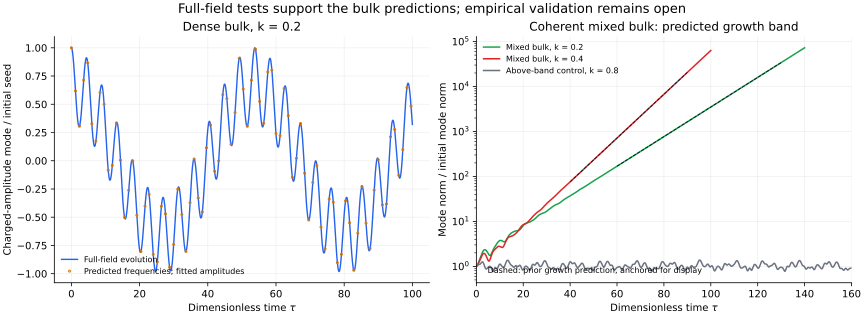

# Reality audit and continuation checkpoint

Read [REPORT.md](REPORT.md) for the audited verdict and [START_HERE.md](START_HERE.md) to resume across AI sessions.

Ten full nonlinear field evolutions with a separate Fourier/RK4 implementation support the previously published uniform bulk frequencies and mixed-branch growth. All 22 source/numerical/prediction checks pass. This is numerical support within the proposed scalar model; unrestricted-3D finite-object stability, quantum lifetime and empirical identification remain open.

The empirical audit identifies a missing ordinary-detector coupling in the displayed leading benchmark and converts the original illustrative scale to physical units. Tau240 corresponds to about 6.49e-35 seconds at that scale; it is not a measured retention time or a lifetime. Claude's unpublished tests remain unknown.

Inspect [SUMMARY.json](SUMMARY.json), [PHYSICAL_SCALES.json](PHYSICAL_SCALES.json), [protocol.json](protocol.json), and [exact diagnostic archive](raw_outputs.tar.gz) with its [manifest](RAW_OUTPUTS_MANIFEST.json).

Run `python3 unpack_raw.py`, then `python3 analyze.py` and `python3 physical_scales.py`. Plotting uses `python3 plot.py`. The full suite uses `python3 run_suite.py`. See the report for preparations, numerical limits, physical access and source references.
