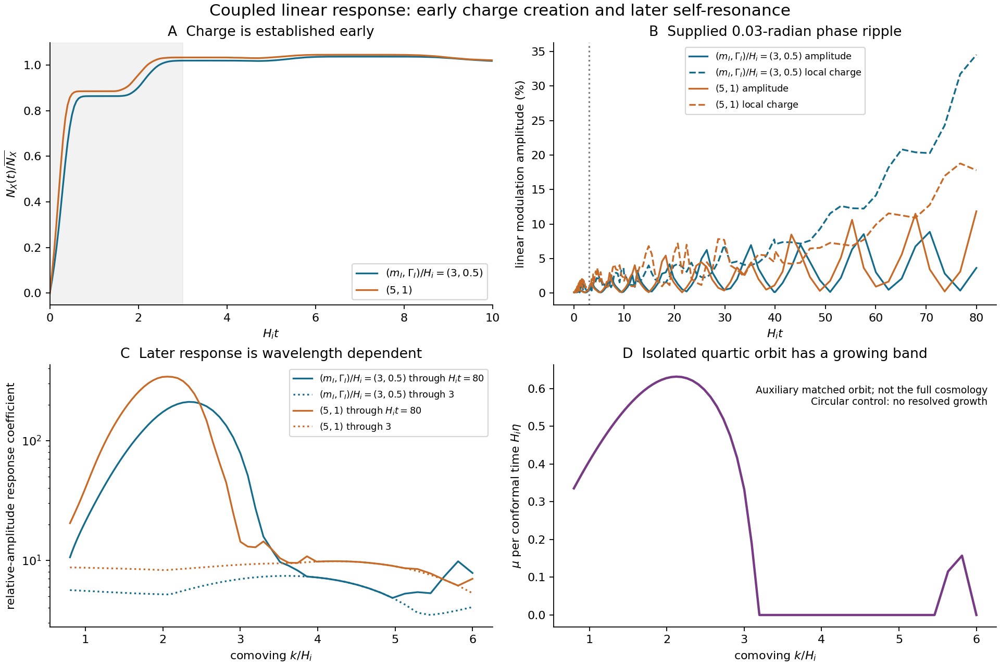

# Coupled perturbations through physical reheating

26 October 2026, America/Chicago. Parent e160356; reviewed context f74fb83.
Claude retains the kinetic calculation. All calculations here are
same-author numerical work, with distinct verification methods.

**The proposed early-instability gate does not close the quiet histories
in the tested linear seed control.** A supplied .03-radian phase ripple
gives less than .75% X-amplitude modulation and about1.4–2.1% local charge
modulation during charge creation. Later response is larger and has a
finite-wavelength band consistent with quartic-condensate self-resonance.
This moves the dependency toward nonlinear breakup and its initial state;
it does not establish the final object population or a cosmological point.

## What was calculated

We evolved the same homogeneous X/Y/Sigma, inflaton, radiation and
Jordan-frame geometry as e160356. Six preselected points keep the hidden
couplings and H_i fixed. For each we propagated the complete12-by12
canonical transfer matrix of the six real charged scalars. Eliminating A0
in Coulomb gauge includes the longitudinal vector in those six degrees
of freedom; it is not counted as a seventh scalar.

The first grid has33 comoving momenta from k/H_i=.01 to40, plus six
infrared diagnostics. The resolved band was refined with65 momenta
from.8 to6. This is624 full scalar/longitudinal mode histories over six
backgrounds, through H_i t=80. The metric, inflaton and radiation
perturbations are not evolved. This is a spectator perturbation test,
not a complete gravitational stability certificate. Background evolution
and mode evolution are simultaneous, without interpolation of a sparse
stored background.

The binding field phi has zero background but also has perturbations.
We separately integrated its decoupled2-by2 transfer matrices at136
momenta for all six histories, with xi_phi=0 at the reference matching
scale. Its time-varying mass is retained. This adds816 neutral-mode
histories. There are no decays, collisions or nonlinear backreaction in
either sector.

## Reheating correction accepted and reproduced

The old18–78% yield deficit belongs to the old slow-reheating grid.
The faster-reheating points reproduce the review's result:

| (m_I, Gamma_I)/H_i | absolute yield / Y_Q, tau64–80 mean |
|---|---:|
| (3,.5) | 1.0454 |
| (5,1) | 1.0474 |
| (10,3) | 1.0195 |

These keep the scale, phase and hidden couplings fixed. They show that a
physical history can reach the target; the reheating rate remains supplied.
They do not predict Y_Q. The older points and the m_I=12 resonance control
are retained in MODE_RESULTS.json, with no parameter adjustment to improve
stability. All yields are homogeneous results before nonlinear feedback.

## Early phase-noise response stays small under the declared preparation

We perturbed the supplied Sigma phase by
`delta theta=.03 cos(k x)`, one wavelength at a time. Radial fields and Y
are adjusted by the same local conditional-minimum preparation recipe;
all initial physical velocities vanish. This is a correlated preparation
perturbation, not independent noise added arbitrarily to heavy fields.
The phase amplitude is supplied, not derived from inflation.

Gauge-invariant responses are the fractional variation of |X| and the
local comoving X charge, normalized to the late background charge. Maxima
are over individual sinusoidal seeds on the stated main band:

| Quiet history | max amplitude modulation through tau3 | max local charge modulation through tau3 | amplitude through tau80 | local charge through tau80 |
|---|---:|---:|---:|---:|
| (3,.5) | .490% | 1.361% | 8.88% | 34.5% |
| (5,1) | .742% | 2.048% | 11.9% | 18.8% |

Tau3 covers the main charge-creation stage. These small early responses do
not show destruction of quiet charge transfer by this seed. They also
are not bounds on every possible initial state. A superposition of many
noisy modes needs a spectrum and correlations; the table is not its RMS.
Spatially averaged first-order cosine perturbations vanish. Local charge
modulation is therefore not a computed shift in the mean relic yield.

Later phase responses are appreciable. They remain linear predictions,
not a nonlinear formation run. Other radial/velocity perturbations have
larger susceptibility, so a physical holder must specify the full state,
not just a mean phase or a one-number phase tolerance.

## A later finite-wavelength band is resolved

The state-independent response norm allows arbitrary small initial field
and velocity perturbations, scaled by each species' initial amplitude and
H_i. Its X-amplitude response in the refined band reaches about210 and340
for the two quiet histories, versus about7.4 and9.8 through tau3. These
are response coefficients in a declared norm, not particle counts or
unconditional growth factors for a cosmic state. Peaks occur near
k/H_i=2.33 and2.06. The finite-time backgrounds are not periodic, so we
do not assign them a constant Floquet exponent.

For an auxiliary explanation, we matched an isolated complex quartic X
orbit at tau10 of (3,.5), preserving its initial field and velocity.
Closing the perturbation monodromy by the orbit's O(2) rotation after a
radial period gives a growing band around the same wavelengths. Its
largest sampled exponent is about.632 per H_i eta at k/H_i=2.123,
with multiplier1.672 per radial cycle. A circular-orbit control has no
resolved growing multiplier. This establishes self-resonance in the
auxiliary quartic orbit and supports that interpretation of later
response. It does not prove equivalence to the full coupled cosmology.

Growth after charge creation can be a precursor to breakup into waves.
At this early phi=0 stage it does not establish bound objects: the
low-energy binding transition and nonlinear evolution are still missing.
Collisions or decays can also change the growth. Neither stable solitons,
the old collapse spectrum nor a formation kernel is derived here.

## Neutral binding-field control

With phi background0,
`m_phi,eff^2=2g_X^2 |X|^2-lambda_phi v^2` is positive on these histories.
Its oscillation can still produce waves. In the computed band, conditional
vacuum-seed estimates keep the phi excitation energy below about.2% of
the background X conformal energy through tau80; the two initial Gaussian
seed conventions give similar values. They show no neutral-mode energy
catastrophe within this interval and band.

The reported energy uses an instantaneous positive-frequency projection
and zeroth-order zero-point subtraction on a prescribed background. It
is not a renormalized interacting stress tensor, an entire ultraviolet
spectrum, a thermal reservoir, or a final particle source certified for
Claude's abundance solver. These conditional estimates must not be
silently added to his benchmark as a completed production history.

The six-field Gaussian reference spectra are likewise diagnostic. They
contain zero-point fluctuations and depend on a supplied positive-frequency
reference. A charge variance at short wavelengths is not a dark-matter
abundance excess. Only the phase-seed responses and state-independent
transfer claims above are used for the early conditional conclusion.

## Verification and limits

Seven mathematical groups pass: Hessian/Ward/A0 algebra; an independent
Radau integration; canonical transfer; tighter tolerance and gauge/global
tangents; the preparation-phase tangent; the isolated quartic orbit; and
neutral binding-field modes. See VERIFICATION_RESULTS.json for actual
errors. The six-field Radau comparison reaches tau3 and agrees within
1.28e-9 in scaled variables. Tightening the primary tolerance changes
tested responses by7.6e-11. The global gauge tangent agrees to4.6e-13.

This is a sampled finite-time linear analysis. It omits metric/inflaton/
radiation perturbations, physical seed selection, damping, nonlinear
backreaction and later formation. The very infrared points are labelled
diagnostics, not a cosmological isocurvature calculation. A positive or
negative instantaneous mass eigenvalue alone is not our stability verdict.

## Consequence for the working theory

The quiet history survives this particular early linear seed test. The
same calculation identifies a later wavelength band that a successor
nonlinear calculation should resolve. That successor must preserve total
gauge charge, track X/Y/Sigma/phi energy and report the wave spectrum before
using a gas or object formation rule. It must begin from a specified
holder-generated state. Claude's existing kinetics remains the abundance
calculation; it is not duplicated or replaced here.

[CORRECTIONS.md](CORRECTIONS.md) records the review's yield, symmetry and
portal corrections and the distinction between a supplied asymmetric
state and a compulsory new CP-violating operator. The cosmic phase,
holder, vacuum density, foundational gravity and distinctive empirical
signal remain open. Closure has still supplied no new physical law.
