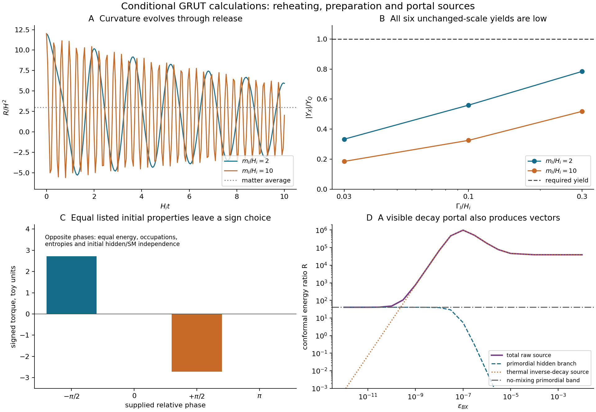

# Reheating, a constrained preparation state, and portal sources

26 October 2026, America/Chicago. Additive follow-up to
`04c53f522fe3d275a5f4f0e3caa61eead5c6f940`; the existing benchmark and
Claude's hidden-plasma calculation are not replaced.

**Result:** a physical curvature evolution can preserve quiet charge transfer
in a specified homogeneous model. It does not supply the required phase or
the full abundance. A finite constrained boundary state makes that phase
freedom explicit. Opening a visible decay portal also opens thermal
production, so that proposed energy outlet needs its own source ledger.
Eleven mathematical verification groups pass. These are conditional model
calculations, not evidence that the new fields exist or a finished theory of
reality.

## What was run

The choices in [PROTOCOL.md](PROTOCOL.md) were fixed before the runs. The
new homogeneous model evolves a quadratic inflaton, radiation, the metric,
and the full three-complex-field tree potential, with
`xi_X=-5/6` and `F=M_r^2-2 xi_X |X|^2`. It retains the heavy-point scale
`H_i=1.3334961939833566e11 GeV` and all dimensionless hidden couplings.
The inflaton is an explicit post-inflationary surrogate, not a fitted
inflation model. Initial relative phases and zero velocities are supplied;
there is no derived holder or switch-off action.

We integrated all six combinations `m_I/H_i=2,10` and
`Gamma_I/H_i=.03,.1,.3` to `Gamma_I t=25`, plus five reference/tolerance/phase
controls. Two further integrations check the central run with SciPy Radau
and a longer endpoint. The primary engine is a C DOP853 implementation.
Ricci curvature is solved from the nonminimal Einstein/scalar equations;
the Hubble parameter evolves independently, so Friedmann conservation is a
check rather than a quantity reset at each step.

## 1. Curvature and reheating: a conditional continuation, with a yield deficit

The inflaton makes `R/H^2` oscillate. Replacing it throughout reheating by
its matter-average value would miss those oscillations. The six runs give:

| m_I/H_i | Gamma_I/H_i | late charge fraction | absolute yield / Y_Q | undamped Y occupation |
|---:|---:|---:|---:|---:|
| 2 | .03 | -.1913 | .3327 | .003524 |
| 2 | .10 | -.1988 | .5596 | .003527 |
| 2 | .30 | -.2187 | .7843 | .003532 |
| 10 | .03 | -.1815 | .1847 | 1.7430 |
| 10 | .10 | -.1815 | .3250 | 1.7103 |
| 10 | .30 | -.1797 | .5182 | 1.6173 |

The charge fraction uses the inherited quartic-condensate normalization.
Its sign is conventional. The yield is per final visible entropy and is
compared with the unchanged `Y_Q=4.8294009077e-9`.

At `m_I/H_i=2`, a quiet transfer persists and the undamped heavy-Y
diagnostic is about one-hundredth of the original prompt-radiation value
`.351718`. At `m_I/H_i=10`, it is much larger. Quietness therefore depends
on the physical release history. **None of these six unchanged-scale runs
produces the required yield.** No mass/Hubble rescaling or parameter
retuning was performed to repair that deficit.

These are homogeneous classical amplitudes and late free-mode diagnostics.
They omit actual mediator decays, their time-dependent populations, quantum
particle production, a thermal hidden bath and fragmentation. In particular,
late Sigma occupation is not the number of Sigma particles that would have
decayed. The table cannot be used as a complete debris or relic ledger.

The central run's longer endpoint changes retained charge by .014% and
charge fraction by .22%; quote the latter as about -.199, not as a
many-digit asymptotic result. A `+/-1e-8` phase perturbation changes its
charge by at most `4.36e-10` relatively. This is a local numerical
sensitivity check, not inflationary phase preparation or a tolerance to
realistic quantum phase fluctuations.

The cold vacuum criterion is
`m_X,vac^2-2.5 H^2>0`, giving `H<.05844 GeV` for the reference mass.
The mass is counted once: an equivalent general expression is
`m_X,vac^2+g_X^2(phi^2-v^2)+xi_X R`, before other background Hessian terms.
At the early `phi=0` condensate the vacuum criterion is inapplicable.
We verified the analytic matter-era origin growth `X proportional to a`
when the positive mass and quartic are neglected. We have **not** certified
the finite-momentum, gauge and metric fluctuation spectrum of the actual
condensate. A negative instantaneous fixed-Y Hessian by itself is not that
certificate.

## 2. Preparation: an explicit neutral state, but the phase remains an input

[BOUNDARY.md](BOUNDARY.md) constructs a coherent-state boundary kernel,
projects it exactly onto total gauge charge zero, and embeds its unitary
evolution in one stationary internal-clock constraint. The state after
projection need not remain Gaussian. Neutral spaces with dimensions 31 and
58 give the same conclusion.

Opposite relative phases have identical initial energy, occupations,
single-mode entropies and zero hidden/SM mutual information. They generate
opposite light-sector charge-transfer torques. In a doubled conjugate
example the initial signed light charge is zero; the two preparations give
torques `+/-2.7153` in the toy units. The cutoff change is .102%.

Thus neutrality, these entropy conditions and an initially uncorrelated SM
factor do not select the charge-producing phase. Homogeneous FLRW also has
zero Weyl curvature for all these phase choices. Adding a Weyl penalty
alone supplies no phase selection within that homogeneous class.

This is a finite charged-mode construction, not a solution of the full
gravitational Hamiltonian/diffeomorphism constraints, a derived cosmic
boundary law, or a physical phase holder. A real Lorentzian boundary phase
does not by itself reweight initial configuration probabilities; it can
still change momenta and subsequent observations.

## 3. Portals: decay outlets bring production sources

[PORTALS.md](PORTALS.md) supplies the conventions, source equations and
analytic bounds. The calculation uses the original prompt-radiation vector
normalization, not a newly computed vector spectrum on the six reheating
backgrounds above.

For hypercharge kinetic mixing, the current field content has zero
one-loop mixed charge trace. A nonzero mixing is allowed matching data; it
is not forced by that one-loop trace. If supplied, it permits both
`A -> SM` and thermal `SM -> A -> X anti-X`.

At `epsilon_BX=1e-7`, the visible decay reduces the inherited primordial
hidden energy ratio from 40.56 to 5.46, but the thermal source adds about
`9.84e5` in the same conformal-energy normalization. The injected pair yield
is `1.663e-7` per visible entropy. These are source quantities, **not a final
symmetric relic abundance**.

For a hot radiation bath, constant masses/degrees of freedom,
Maxwell-Boltzmann production and the stated linear decay system, an analytic
bound gives

\[
R_{\rm total}\ge40.5626 B_X^{3/2}+39184.0(1-B_X)\ge40.5626.
\]

Opening this portal therefore cannot reduce the raw vector injection below
the original primordial band in that source model. The numerical time
profiles use a kinetic-shape approximation; the integrated pair-number
identity and the prompt-energy lower bound also follow directly from
branching ratios and redshifting on-shell parents. They are not a full
momentum-dependent plasma solution. Low reheating temperatures, different
mass histories, thermal corrections, inverse hidden reactions and later
processing require their own treatment. The new reheating histories are
hot at `T~m_A`, but their primordial vector spectra were not recalculated.

For the scalar portal `b_Hphi phi^2 H^dagger H`, the earlier illustrative
coupling is `b_Hphi=5e-11` (`kappa_Hphi=2b_Hphi`). In a vacuum-mass thermal
Higgs-decay control it injects `2.237e-8` X pairs per visible entropy, whose
unprocessed rest mass is 9.39 times the inherited dark-matter budget.
Thermal masses and hidden processing were not computed; this is a warning
against treating a tiny detector coupling as automatically irrelevant to
the early universe, not an exclusion.

The archived ATLAS bound `Br(h->invisible)<.107` gives the one-channel
tree estimates `|b_Hphi|<.00505` and `|lambda_HX|<.00714`, under the stated
production/invisibility assumptions. These are not a complete or latest
global constraint. An isolated scalar-loop contribution requires
`beta_b=g_X^2 lambda_HX/(8 pi^2)` when the H-X bridge is nonzero; zero portal
values must be stated at matching scales rather than treated as universal
identities. No complete RG evolution or pole-mass matching was performed.

The heavy-vector contact gives less than `5.1e-13` xenon events per tonne
year even at the unit photon-mixing reference, the declared flux and zero
momentum form factors. This particular contact is unpromising as a signal.
The old scalar benchmark has `sigma_p(0)=3.93e-47 cm^2` for the declared
hadronic input. Neither is a detector likelihood or a demonstrated
distinctive multi-target recoil shape.

## 4. Cold leakage: the existing included channels still pass

Reapplying the earlier coherent and antiparticle-pair calculations with
the full heavy-Y denominator gives
`alpha_6=2.10886e-31 GeV^-2`, rather than only its leading expansion.
The correction factor is 1.25392; the included cold-core loss is
`Gamma t_0=7.08368e-17`. Pair emission is 2653 times the coherent channel.
This reuses and credits the earlier rate calculation; it is not a new
in-medium calculation or a complete lifetime. Hot profiles, distorted
waves, other channels and a population average remain outside it.

## What this changes in the theory

The [explicit architecture](../grut_exact_architecture_20261026/THEORY.md)
now has a worked physical reheating representative and a constrained
preparation example. It has additional source constraints on portal
choices. It still has no derived cosmic state, phase holder, vacuum
density, microscopic gravity or distinctive observed signal. Closure has
not produced a new law beyond the adopted dynamics and preparation data.

Claude's existing kinetic calculation remains the next abundance decision
for the original heavy point. Its no-new-portal control should remain
separate from the new sources here. If an extended source is studied, the
fixed allowance denominator remains `4.4e-10 GeV` per visible entropy, and
the source's momentum and timing must accompany its energy. Formation
rules and initial-spectrum alternatives must retain their labels.

Numerical evidence, source pins and reproduction commands are in
[REHEATING_VERIFICATION.json](REHEATING_VERIFICATION.json),
[VERIFICATION_RESULTS.json](VERIFICATION_RESULTS.json),
[SOURCES.md](SOURCES.md) and [REPRODUCE.md](REPRODUCE.md).
