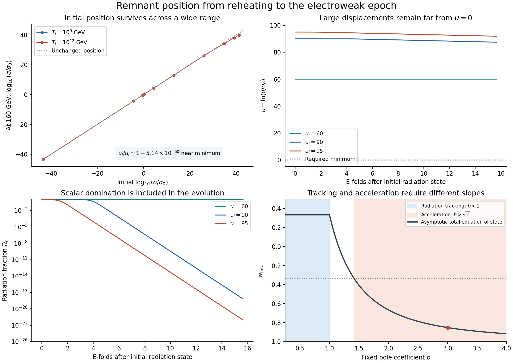

# Can the remnant select its position after reheating?

**Result:** the controlled late kinetic-pole regime of the borrowed
Camargo-Molina–Markkanen–Scott action preserves a prepared small displacement,
but does not bring a broad range of misplaced homogeneous fields to that
displacement before electroweak symmetry breaking. This closes one proposed
repair of preparation in the worked histories. Today's dark-energy value
remains underived.

This is an additive continuation of [the inflaton decay calculation](../grut_inflaton_channel_20261022/REPORT.md)
at 9d0362c. It follows the owner's instruction to prioritize field-position
selection and keep reheating as a side branch. No old packet or canonical
GRUT-RAI implementation is changed. The action and exponential-potential
attractor theory have published origins; this is a calculation of their
consequences, not a new GRUT mechanism.

## What was actually solved

After the inflaton has decayed, write s=sigma/M>0 and
u=ln(s/s0), with c=1, b=3 and kappa=3/2. The same action's N=55,
A_s=2.1e-9 inflation calibration gives alpha=1.05623e-5. The controlled
small-s limit is

\[
\mathcal L=\frac{M^2R}{2}-\frac{b^2M^2}{2}(\partial u)^2-U(u)
+\mathcal L_r,
\qquad U=V_0+\rho_*[e^{2u}-2e^u],
\]
\[
V_0=\lambda v^4/4,\quad
s_0=V_0/(\alpha^2M^4)=3.01131\times10^{-56},\quad
\rho_*=V_0^2/(\alpha^2M^4)=3.55652\times10^{-48}\;\mathrm{GeV}^4.
\]

The small target is calculable within this classical potential; the question
is whether the field is driven there. The assumed zero of absolute energy
at the final Higgs minimum is inherited from the parent proposal and is
not protected against quantum corrections by this calculation.

The false-phase Higgs constant V0 is included in gravity. The bath is ideal
radiation with g=106.75, T proportional to a^-1, and a stabilized h=0
phase until the stopping temperature 160 GeV. These are conditional history
assumptions. A thermal completion and an electroweak transition are not
silently supplied. The displayed rho* is the energy obtained **if** u=0 is
prepared and retained after the Higgs changes; it is not a derived present
density. The empirical dark-energy density is not an input to this run.

The scalar equation, its kinetic energy, the radiation equation and the
Friedmann constraint are solved together. When the scalar becomes important,
the expansion responds to it. Initial temperatures 10^9 and 10^12 GeV give
15.6481 and 22.5558 e-folds respectively. There are 26 zero-velocity starts
and eight nonzero-velocity controls; every start is over 98% radiation by
energy. No prior stochastic ensemble is transported into these starts and
no start is assigned a probability.

## Three linked consequences

**1. A minimum exists, but its restoring rate is far too small in this regime.**
Near u=0, the canonical mass satisfies

\[
m_{\chi,0}^2=\frac{2\rho_*}{b^2M^2},\qquad
\frac{m_{\chi,0}^2}{H_{160}^2}=1.02491\times10^{-58}.
\]

A scaled variational equation and a separately evaluated Green-function
integral give, for initially stationary infinitesimal displacements,

\[
\boxed{\frac{u_{160}}{u_i}
\simeq1-5.14058\times10^{-60}.}
\]

Thus the displacement is reduced by an extremely small fraction; it is
not reduced *to* 5e-60 of its starting value. The pure-radiation leading
coefficient is m^2/(20H_end^2), with the small retained Higgs constant
changing it slightly. Ordinary floating-point endpoint maps round this
effect away; the scaled calculation resolves its leading coefficient.
Finite offsets u=±0.1, ±1 and ±10 likewise retain their preparation at
the displayed precision. These statements concern classical homogeneous
response, not quantum state localization.

**2. Large displacements cannot be repaired within the available expansion.**
For positive energy and a constant pole metric, Friedmann gives the necessary
field-distance bound

\[
\left|\frac{du}{dN}\right|\leq\frac{\sqrt6}{b},\qquad
N_{\mathrm{required}}\geq\frac b{\sqrt6}|\ln(s_i/s_0)|.
\]

For u_i=95 the minimum is 116.35 e-folds away even at the maximum allowed
speed. Only 15.65 or 22.56 are available in the specified intervals. This
necessary bound includes arbitrarily chosen allowed initial velocity;
it is not a slow-roll estimate.

The actual field rolls much more slowly. Representative zero-velocity
results for T_i=10^9 GeV are:

| Initial u | u at 160 GeV | Radiation fraction at 160 GeV | Would-be post-EW potential / rho* |
|---:|---:|---:|---:|
| -10 | -10, to shown precision | 0.994895 | 2.061e-9 |
| 0 | 0 | 0.994895 | 1 |
| 10 | 10, to shown precision | 0.994895 | 4.852e8 |
| 60 | 59.999999933 | 0.994893 | 1.304e52 |
| 90 | 87.447930817 | 6.626e-19 | 9.043e75 |
| 95 | 91.892794397 | 9.131e-23 | 6.562e79 |

The last column is a diagnostic A*s_end^2 after removing the Higgs false-phase
term at a fixed coordinate. No instantaneous physical transition or ensuing
late history has been simulated. In the large starts, the scalar already
drives accelerated expansion before the stopping surface; assuming a
radiation-only H would hide this failure. Raising T_i to 10^12 GeV barely
changes these endpoints, because the added early interval has greater
Hubble friction. A velocity control u_i=0, u'_i=0.1 instead freezes near
u=0.100505: damping velocity also does not select position.

**3. The same fixed exponential slope cannot provide both proposed roles.**
Far above s0, or after electroweak breaking, the canonical potential is
exponential with slope magnitude ell=2/b. The standard flat-FRW scalar-plus-
radiation attractors of Copeland, Liddle and Wands give:

| Role in the pure exponential regime | Requirement | Consequence |
|---|---|---|
| Stable radiation scaling | ell^2>4, or b<1 | Omega_scalar=b^2, w_total=1/3 |
| Scalar-dominated accelerated expansion | ell^2<2, or b>sqrt(2) | w_total=-1+4/(3b^2) |

These open ranges do not overlap. Twelve phase-plane controls converge to
their analytic attractors, with stability eigenvalues separately checked.
For b=3 the large-field solution has u'=-2/9 and w=-23/27; the large-start
histories approach precisely this behavior. This is established exponential
potential physics applied to this action. It does not exclude a model whose
slope or interactions change in an independently specified way.

## What this decides and what remains open

The paper's section 5 suggests that inflationary fluctuations could relax
away after inflation before the electroweak epoch. This calculation does
not transport those fluctuations or assess their spatial dynamics. It
does show that the homogeneous late-pole equations do **not** generally
restore misplaced coarse positions in the specified interval. Removing
waves or damping their energy cannot be equated with selecting the zero mode.

This result leaves an early canonical preparation stage as a separate
possibility. That stage must produce its state before the pole suppresses
restoring forces, and must survive fluctuations and the changing metric.
The previous fixed-inflaton stochastic probe is not a proof that every
such stage fails. No all-actions impossibility theorem is claimed here.

The truncation is controlled on the tested starts: a conservative
s_max=5.455e-15 gives metric corrections below 1.49e-29 and small-s potential
component corrections below 2.19e-14. A sourced heavy inflaton is integrated
out, not declared exactly zero: its adiabatic correction scale is below
8.96e-15 for these starts. These are classical estimates, not a quantum
completion. A full thermal trace, stochastic transport, spatial gradients,
loop corrections and the electroweak transition have not been computed.
In particular, a nonconformal bath is not covered by the ideal-radiation
conservation law without its corresponding energy exchange.

The next mechanism must supply a finite basin of attraction before this
late regime, or an explicit new interaction that selects a position during
it. Its trigger, stationary position, stochastic width and energy exchange
must follow from a stated action. Neither s0 nor the measured density can
be inserted as that new rule's target and then advertised as its output.
This packet is a scoped negative result about a proposed repair; it is
not an action that derives dark energy.

## Reheating side constraint retained

The owner's supplied review independently checked the two formulas in
9d0362c but did not rerun its 42 checks. Its new completion requirement is
recorded as

\[
\Delta N_{\rm eff}=2.857924\,\Gamma_\chi/\Gamma_{\rm vis}
\quad\Rightarrow\quad
\Gamma_{\rm vis}/\Gamma_\chi\geq2.857924/\Delta N_{\rm eff}^{\max}.
\]

Targets 0.3 and 0.15 therefore require ratios at least 9.53 and 19.05.
These are conditional arithmetic examples, not a newly adopted current
observational bound or a held-out prediction. No visible interaction was
constructed in this continuation, and this constraint does not select u.

## Verification and files

There are **41 internal numerical conditions**, four step/tolerance
refinements, a separate cosmic-time organization of four scalar histories,
two independently integrated minimum-response quadratures, analytic
phase-plane stability checks and a fresh full replay. All are one author's
work. Same-code replay is not outside replication. See
[verification](VERIFICATION.md), [derivation](MATHEMATICS.md),
[assumption ledger](LEDGER.md), [sources](SOURCES.md),
[protocol](PROTOCOL.md), [reproduction](REPRODUCE.md) and
[raw endpoint map](data/endpoint_map.csv).
