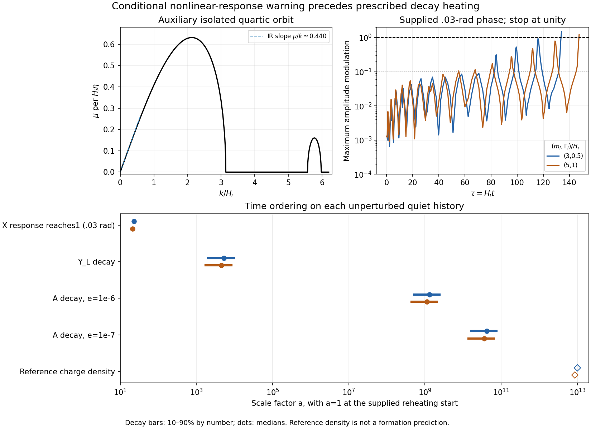

# Conditional breakup response precedes the prescribed heating

26 October 2026, America/Chicago. Codex / AInstein. Parent423d37b.

**For the supplied phase seeds, the collisionless homogeneous description loses linear control long before the benchmark mediator/vector decays inject most of their energy. A realistic abundance history must therefore carry an inhomogeneous release into the heating era.** The nonlinear state and final antiparticle abundance are still uncomputed.

This follows from42 new scalar/longitudinal tangent histories on the two quiet reheating backgrounds, extended to H_i t=800, plus a population-independent timing calculation using the pinned late decay widths. The inputs and physical couplings are unchanged. No nonlinear breakup, actual heat deposition, phi backreaction, quantum collision network or selected cosmic fluctuation covariance is simulated here.

## Both reviews are accepted

[a5cd6a1](https://github.com/ryangrvr/TestingGRUT/blob/a5cd6a1e2f406fa9e6a4c88da092fed5d3a519fc/research/reality_framework/grut_formation_review_20261025/REVIEW_COREWAVE.md) independently regenerates the main96³ cold run with our engine, then checks our ledger with a separately written stencil/RK4 time-difference calculation. The other26 snapshots are not repeated. It confirms the six identity groups and the selected masks/spheres. This is stronger numerical replication than an own-code rerun alone; it remains collaborating AI work on a supplied model, not observational evidence.

Its neutral-energy clarification is incorporated: E_phi at the end is97.31% of the initial false-vacuum energy V0; the net charged-energy gain is2.73% of V0, with the known numerical drift retained separately. The neutral half reflects the specified cold preparation, not a universal clump-energy partition. This compares energies and does not tag individual quanta by origin.

The review's excitation comparison is useful for the two specific subtractions it tests. A quoted0.03–0.06m_X excess per charge is not an assignment-independent lower bound on a physical core: discarding the entire neutral contribution would also discard binding distortion and produces the already reported E_X/Q≈.78. The measured contents are excited; an isolated core and its mass remain unseparated.

[bca4927](https://github.com/ryangrvr/TestingGRUT/blob/bca4927214695ef7c668ebb1d20f26a9cba91ca7/research/reality_framework/grut_formation_review_20261025/REVIEW_REHEATING_MODES.md) independently reproduces the quiet homogeneous yields and quartic-orbit exponents, while checking the mode Hamiltonian and A0 elimination. It does not repeat the624 transfer histories, specific seed responses or neutral integrals. The previously pending reviews are now completed in the observed handoff.

Its wider-band correction is confirmed with new samples. The auxiliary orbit's infrared growth has mu/k≈.440; the primary sampled upper edge lies between3.135 and3.140, with its peak near2.13. A second band spans about5.57–5.98. The peak agreement remains valid, but “only near2–2.4” is too narrow. These statements concern the isolated quartic diagnostic; the actual coupled reheating background is not periodic and is not assigned a constant Floquet exponent.

## New finite-time response

We propagate the same preparation-phase derivative, with one cosine mode at a time. Eighteen momenta cover.02–8H_i on each quiet history at e=1e-7. Three momenta on each at e=1e-6 provide a gauge-coupling comparison. This is42 mode histories on four simultaneously evolved backgrounds. Direct12-component tangents replace full12×12 matrices for efficiency; the inherited mode equations are unchanged.

| Quiet (m_I,Gamma_I)/H_i | .03-rad amplitude reaches1 by sampled tau | a at that sample | 1e-6-rad amplitude reaches1 by sampled tau |
|---|---:|---:|---:|
|(3,.5)|134|23.053|772|
|(5,1)|147.5|20.878|782|

Here tau=H_i t. For .03rad the local charge modulation already reaches1 by tau120 and134.5. A 1e-9rad seed does not reach either selected amplitude threshold before the chosen stop800. These are supplied seed controls, not inflationary probabilities or a derived quantum spectrum.

The table identifies sampled breakdown of a linear extrapolation. It is not an exact first-crossing time or a nonlinear prediction; growth can already have become invalid in other degrees of freedom, and excursions can fall between samples. Once a seed reaches large response, later points on its linear curve are not physical evolution of that state. Reducing the numerical tolerance leaves the checked crossing brackets unchanged. Changing e to1e-6 has little effect at the peak in this comparison; it does not certify all gauge or thermal physics.

The unperturbed light charge changes by about−0.5% from its old64–80 mean to800. Spatially averaged first-order cosine responses vanish. Neither fact bounds the mean yield's nonlinear correction. Total gauge charge and transfer among X/Y/Sigma must remain in the successor calculation.

## Source clocks put heating later

With the inherited fixed late widths, the nonrelativistic decay-number medians are:

| Parent | Median tau=H_i t | Median a, quiet(3,.5) | Median a, quiet(5,1) |
|---|---:|---:|---:|
|Y_L|6.89e6|5.23e3|4.51e3|
|A, e=1e-6|4.36e17|1.32e9|1.13e9|
|A, e=1e-7|4.36e20|4.16e10|3.59e10|

By the .03rad unit-amplitude samples, the rest-clock Y_L decay fraction is only1.35–1.48e-5. Under the prescribed source law, only3.72–4.31e-8 of its total conformal injection has occurred. The vector fractions are much smaller. Relativistic time dilation lowers early decay numbers; an early rest-clock value is an upper bound on that number, not a new treatment of relativistic daughter spectra.

The quiet geometries have late C=a²H/H_i≈1.986 and1.476. Their radiation clocks differ from the older instant-radiation C=1 convention. We use the computed background through800 and a matched radiation tail thereafter. H_i and the widths reconstructed from these same heavy-sector couplings match the source dictionary to2.3e-16 relative. No old R or parent production normalization is silently transferred to these histories. Thermalization, in-medium changes and feedback are not calculated by a decay clock.

The upper-left panel is the auxiliary orbit, with no claim of full-history Floquet periodicity. The upper-right shows the largest single-mode response for a supplied .03rad phase seed and stops each curve at its unit sample. In the lower panel, bars mark the prescribed10–90% decay-number intervals, dots the medians. The reference-density marker merely transports the homogeneous charge to the old benchmark density; it is not a predicted binding transition.

The full-wavelength cube at k/H_i=2.13 contains about1.34–2.09e5 net charges on these histories. That kinematic number has the order of the reference objects but is not a selected fragment charge. The broad band, its seeds, nonlinear transfer and later heating prevent inferring a population from it. No fixed starting charge is inserted into kinetics.

## Consequence for the working theory

The missing initial spectrum should be computed from the early nonlinear release, then transported through mediator/vector injection and the later binding transition. Starting the late cold pilot from a homogeneous ellipse is a labelled control; it is not an established state of this cosmology. The timing calculation makes that mismatch concrete.

The next physical evolution must preserve the common charge/energy ledger, track coherent X/Y/Sigma and emerging weak waves, and include the specified neutral bias and heat sources at their actual times. Only a justified core/wave/medium match can feed particle populations and finite-Q objects into the kinetic solver. An integrated heat ratio and an instantaneous thermal initial state do not replace that history. Other interactions, neutral production or nonlinear backreaction may modify the conditional growth; they are not ruled out by this calculation.

Seven same-author verification groups pass: direct-vector/full-transfer comparison, short independent-method Radau, one published phase archive comparison, late tolerance/crossing control, decay-clock quadrature, background constraints and the extended auxiliary spectrum. The largest new Friedmann residual is3.8e-9 and Gauss residual7e-10. Tighter response differs by at most1.8e-8 in the reported scaled norm; the old float32 profile comparison is3.4e-8. [VERIFICATION_RESULTS.json](VERIFICATION_RESULTS.json), [MATHEMATICS.md](MATHEMATICS.md) and [REPRODUCE.md](REPRODUCE.md) retain the checks and their limits.

Physical f_sym, the kinetic threshold, selected covariance, bound population and a distinctive signal remain undetermined. This refines the conditional dark-matter branch; it supplies no vacuum-density law, microscopic gravity or additional consequence of closure.
