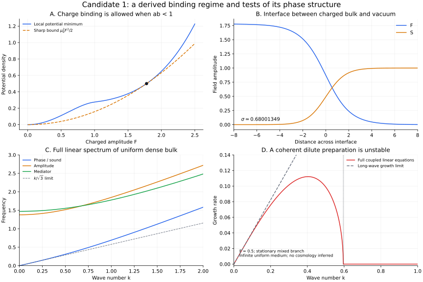

# GRUT: a working theory of interacting fields, localized matter and records

20 October 2026, America/Chicago · Candidate 1 synthesis and derived predictions · Author research; independent scientific review pending

**Central proposal:** physical structures and records are organized states of interacting quantum fields in a common gravitational spacetime. In the proposed new scalar sector, conserved charge changes the field controlling its own mass. This feedback permits localization, saturates at high density, and allows interactions to leave distinguishable charge records. Sources, probes, environments and observers are physical parts of the same theory whenever their operation is claimed to be explained.

This document gives the proposal an explicit action, a sharp classical binding boundary, a bulk phase, a surface cost, and wave/instability predictions. It is a working effective theory with assumed ingredients. It is not an established unique law of reality. No new experimental evidence for its additional fields is supplied.

The original scalar mechanism belongs to the established Friedberg–Lee–Sirlin/Q-ball family [L1–L3]. The new work here is the explicit derivation and numerical checking of these predictions for the chosen quartic extension, the integration with the completed finite-time campaigns, and the resulting construction brief. Deriving a consequence here does not establish priority for it in the wider literature.

## 1. The common law

Use natural units, signature (-,+,+,+), and g_X for the scalar coupling. The inherited leading action is

\[
\begin{aligned}
S_0=\int d^4x\sqrt{-g}\bigg[&\frac{M_P^2}{2}R-\rho_\Lambda
+\mathcal L_{\mathrm{SM}+\nu_R}
-\frac12(\nabla\phi)^2-|\nabla X|^2-\frac12(\nabla D)^2-U\bigg]
+S_{\mathrm{boundary}},\\
U={}&\frac{\lambda_\phi}{4}(\phi^2-v^2)^2
+g_X^2\phi^2|X|^2+\lambda_X|X|^4
+\frac12(m_{D0}^2+h_D^2\phi^2)D^2+\frac{\lambda_D}{4}D^4.
\end{aligned}
\]

X carries a conserved global U(1) charge at this EFT scope. The real field phi controls its mass and binding environment. The real reporter D has an explicit organization-dependent mass. All fields contribute to the stress tensor sourcing the common metric. Ordinary matter and its interactions are specified by the adopted Standard Model plus right-handed neutrinos; they have not been generated from scalar droplets.

The [original Candidate 1 specification](../grut_candidate_1_20261018/GRUT_CANDIDATE_1.md) defines the states, constraints, apparatus assumptions, symmetries, matching and cutoff. The quantum EFT also includes symmetry-allowed counterterms, curvature terms, portals and higher operators at the order used. Finite zeros at a chosen matching scale do not protect those coefficients from running. The displayed polynomial alone is not a complete quantum or ultraviolet theory.

The physical theory datum is this law together with a permitted global preparation, boundary conditions, calibrated constants, and a stated observable/apparatus. Merely requiring a closed whole does not choose any of them.

## 2. What makes an object possible

First restrict to the leading classical flat-space scalar sector, with D=0. Define

\[
\tau=g_Xvt,\quad \mathbf x=g_Xv\mathbf r,\quad
X=\frac v{\sqrt2}(u+iw),\quad S=\phi/v,
\qquad a=\lambda_\phi/g_X^2,\quad b=\lambda_X/g_X^2.
\]

Take a,b>0. With F squared=u squared+w squared,

\[
V(S,F)=\frac a4(S^2-1)^2+\frac12S^2F^2+\frac b4F^4,
\qquad q=w\dot u-u\dot w.
\]

The full equations retain gradient and time dependence. Minimizing the potential only over S gives a useful exact pointwise envelope:

\[
S_{\min}^2=\max(0,1-F^2/a),\qquad
V_{\min}(F)=
\begin{cases}
\tfrac12F^2+\tfrac14(b-1/a)F^4,&F^2\le a,\\
\tfrac a4+\tfrac b4F^4,&F^2\ge a.
\end{cases}
\]

At ab<1 the low-density envelope has an attractive quartic. Its upper branch has a positive quartic. The original two-field potential is nonnegative. The feedback permits binding without making that potential unbounded.

The energetic boundary can be sharpened beyond this qualitative argument. Direct minimization gives

\[
\boxed{\mu_*^2=\inf_{F>0,S}\frac{2V(S,F)}{F^2}
=\min(1,\sqrt{ab}).}
\]

For ab<1 the infimum is attained at S=0, F squared=sqrt(a/b). For ab>=1 it is 1, with a vacuum/dilute limiting minimizer; the critical case has additional degeneracy. This is an algebraic statement about the full displayed potential, not an adiabatic replacement of its dynamics.

For every finite-energy classical configuration in this flat sector, completing squares gives

\[
\begin{aligned}
\bar E-\mu_*\bar Q=\int d^3x\bigg[&
\frac12(\dot u-\mu_*w)^2+\frac12(\dot w+\mu_*u)^2
+\frac12\dot S^2\\
&+\frac12(|\nabla u|^2+|\nabla w|^2+|\nabla S|^2)
+V-\frac12\mu_*^2F^2\bigg]\ge0.
\end{aligned}
\]

Completing the opposite signs also bounds negative charge. Therefore

\[
\boxed{\bar E\ge\mu_*|\bar Q|.}
\]

The free X-carrier mass is 1 in these dimensionless energy-per-charge units. Consequently:

- If ab>=1, no configuration in this sector can have Ebar below abs(Qbar). This excludes binding below the free-carrier threshold; it does not exclude every transient or metastable structure.
- If ab<1, large charged trial droplets have energy per charge approaching mu_star=(ab)^(1/4)<1. A smooth wall costs area while the favorable bulk grows with volume. Thus sufficiently large charge admits configurations below the free-carrier threshold. This trial construction does not by itself prove that every preparation forms a droplet, that a particular minimizer is attained, or that every perturbation is stable.

In original parameters the energetic binding class is

\[
\boxed{g_X^4>\lambda_\phi\lambda_X.}
\]

This is the model's precise energetic entry point for localized charged matter. It does not explain why these fields, couplings or initial charge exist.

## 3. The dense phase and its surface

Consider a homogeneous circular configuration u+iw=F exp(-i Omega tau), S=0, at fixed positive charge density n=Omega F squared. Its energy density is

\[
\epsilon(n,F)=\frac{n^2}{2F^2}+\frac a4+\frac b4F^4.
\]

Minimizing over F gives

\[
F^2=(n^2/b)^{1/3},\quad
\Omega=b^{1/3}n^{1/3},\quad
\epsilon(n)=\frac a4+\frac34b^{1/3}n^{4/3},\quad
p(n)=\frac14b^{1/3}n^{4/3}-\frac a4.
\]

Zero pressure selects coexistence with the empty vacuum:

\[
\boxed{\Omega_0=(ab)^{1/4},\quad
F_0=(a/b)^{1/4},\quad
n_0=a^{3/4}b^{-1/4},\quad
\epsilon_0=a.}
\]

At the unchanged benchmark a=1,b=0.1, Omega0=0.5623413252, F0=1.7782794100, n0=1.7782794100 and epsilon0=1. These are bulk limiting values. The existing Qbar approximately 399 object has Omega approximately 0.8 and Ebar/Qbar approximately 0.9111; it has a substantial surface and is not already this limit.

The planar interface at Omega0 obeys the full two-field boundary-value problem

\[
F''=(S^2+bF^2-\Omega_0^2)F,\qquad
S''=[a(S^2-1)+F^2]S,
\]

with (F,S) going from (F0,0) to (0,1). Its grand-potential surface cost is

\[
\sigma=\int dx\left[\frac12F'^2+\frac12S'^2
+V-\frac12\Omega_0^2F^2\right].
\]

**New calculation in this packet:** the resolved planar branch gives sigma approximately **0.680013489**. Expanding the half-domain from 16 to 24 and tightening the residual tolerance from 1e-6 to 1e-8 changes sigma by 4.20e-10. The refined first-integral residual is 2.49e-10 and its maximum endpoint slope is 1.15e-8. Those are numerical consistency diagnostics, not a rigorous uncertainty certificate or proof that this is the unique least-tension interface.

For large spherical flat-space droplets, this interface predicts

\[
R\sim\left(\frac{3\bar Q}{4\pi n_0}\right)^{1/3},\qquad
\bar E\simeq\Omega_0\bar Q+\kappa\bar Q^{2/3},\qquad
\kappa=(36\pi)^{1/3}\sigma n_0^{-2/3}\simeq2.240448603.
\]

Hence Ebar/Qbar approaches 0.56234 with a leading Qbar^(-1/3) surface correction, and Omega=dEbar/dQbar approaches the same limit with coefficient 2 kappa/3. Solving the truncated asymptotic expression for Ebar=Qbar gives approximately Qbar=134, but **that is not a calculated critical charge**: the asymptotic expansion is not controlled near that crossover. No existing collision or radial-profile output was fitted to obtain sigma or kappa.

This large-Q limit belongs to the flat model. At fixed gravitational coupling, increasing charge eventually requires gravitating solutions and can invalidate the flat approximation.

## 4. Waves inside the dense phase

The bulk equation of state gives dp/depsilon=1/3. This can also be checked directly without integrating out S. Write

\[
u+iw=e^{-i\Omega\tau}(F+\eta+i\xi)
\]

around S=0, Omega squared=b F squared. The exact linear equations are

\[
\ddot\eta-\nabla^2\eta+2\Omega\dot\xi+2\Omega^2\eta=0,
\qquad
\ddot\xi-\nabla^2\xi-2\Omega\dot\eta=0,
\]

while the S perturbation decouples at this order. Their frequencies are

\[
\boxed{\nu_\pm^2(k)=k^2+3\Omega^2
\pm\sqrt{9\Omega^4+4\Omega^2k^2},\qquad
\nu_S^2(k)=k^2+F^2-a.}
\]

At the coexisting dense phase with ab<1 all squared frequencies are nonnegative, and

\[
\nu_-^2=\frac13k^2+O(k^4),\quad
c_s=1/\sqrt3,\quad
\nu_+(0)=\sqrt6\,\Omega_0.
\]

At the benchmark, the amplitude gap is 1.37744931 and the mediator gap is 1.47046852. These predictions apply to a uniform rotating bulk at leading classical order. They do not establish stability of a finite wall, an excited droplet, a collision trajectory, or its quantum lifetime. A long-wavelength small-amplitude wave test in a sufficiently large bulk region can check them directly.

## 5. Why a coherent dilute field can fragment

There is also an exact uniform mixed branch with S squared=1-F squared/a and Omega squared=1+(b-1/a)F squared. Its n=Omega F squared gives the long-wavelength phase-mode coefficient

\[
c_s^2=\frac{n}{\Omega\,dn/d\Omega}
=\frac{1-\Omega^2}{1-3\Omega^2}.
\]

In the part with 1/3<Omega squared<1 and ab<1, this coefficient is negative: sufficiently long waves grow instead of propagating as stable sound. The calculation is around a stationary coherent preparation; it does not claim that arbitrary dilute matter or the vacuum is unstable.

For the explicit unfitted choice F=0.5 at a=1,b=0.1:

- S=0.8660254 and Omega=0.8803408.
- The long-wave growth rate is approximately 0.412082 times k.
- The zero-frequency boundary of the unstable band is k approximately 0.5953450.
- A full coupled six-variable linear-generator scan, at spacing 0.0005, gives its largest growth approximately 0.1121396 at k approximately 0.4035.

The code retains the mediator perturbation; the growth scan is not obtained by imposing the local envelope as an exact dynamical law. These provide a clean preparation and predicted wavelengths for Claude to test. They are not a new executed nonlinear fragmentation experiment, and not a derivation of a cosmological initial state. The previously completed finite Gaussian clouds are separate, initially nonstationary preparations.

## 6. Interactions and records

For u+iw=F exp(-i theta), charge and current are

\[
q=F^2\dot\theta,\qquad \mathbf j=-F^2\nabla\theta,
\qquad \dot q+\nabla\cdot\mathbf j=0.
\]

Relative phases can therefore redirect charge during overlap. The [earlier two-object report](../grut_candidate1_two_object_20261019/REPORT.md) derives the initial plane flux for its symmetric preparation, proportional to minus sin(theta). That initial formula is not a fitted force or a coupling kept constant through a collision.

The [completed follow-up](../grut_candidate1_two_object_20261019/persistence/REPORT.md), pinned at [8222721](https://github.com/ryangrvr/TestingGRUT/commit/822272155454a31ceaad9f01ecec1560ddee1494), contains 31 additional evolutions: 12 persistence/selected-mode runs, 13 Gaussian assembly/control runs and 6 exploratory phase-to-charge record/control runs. The Gaussian widths 4 and 6 retain approximately 81% and 55% of total charge inside measured cores; a matched rigid-field control retains approximately 1.6%. Width 8 remains marginal. Opposite quarter-cycle encounter phases leave right-core charges around 519 and 260, while a missed encounter stays near 400 throughout the registered late readout windows.

These results demonstrate conditional assembly and a finite record predicate under the full chosen scalar law. They do not demonstrate one uninterrupted cloud-to-collision-to-detector trajectory. The record comparison supplies an ideal charge observable and geometric address; no self-contained readout apparatus, repair cycle or reusable computer was implemented.

## 7. The unresolved transverse mode has a sharper diagnostic

The prior m=1 response is resolution-sensitive. Its positive canonical norm can change through neutral motions as well as shape deformation. In the continuum, translations and rotations supply exact tangent solutions about **any** sufficiently smooth full trajectory, including a collision.

For any background field or canonical momentum B(t,rho,z), an infinitesimal transverse translation gives

\[
\delta B_{\mathrm{translation}}=-\partial_\rho B\cos\varphi,
\]

and a small tilt of the collision axis gives, up to the orientation convention,

\[
\delta B_{\mathrm{rotation}}=(\rho\partial_zB-z\partial_\rho B)\cos\varphi.
\]

The same generators act on the initial momenta. Translation/rotation invariance of the continuum PDE proves these are tangent solutions by differentiating the symmetry-related background family. Their chosen norm need not be constant during a collision.

The existing opposite-shift seed is not the full rotation generator: rotating a prepared encounter also rotates its velocity field. Its measured growth cannot be assigned entirely to either a neutral mode or an instability. Test the exact symmetry-generated trajectories first, establish convergence of their residuals, and then measure the independent shape response using a declared alignment/projection. Projection must not remove a physical growing mode merely because that improves the result. Full finite-amplitude 3D backreaction remains a separate test.

## 8. Gravity, quantum mechanics and internal environments

Gravity comes from the adopted metric action:

\[
M_P^2G_{\mu\nu}+\rho_\Lambda g_{\mu\nu}=T_{\mu\nu},
\quad T_{\mu\nu}=-\frac2{\sqrt{-g}}\frac{\delta S_{\mathrm{matter}}}{\delta g^{\mu\nu}}.
\]

Binding energy, gradients, pressure and radiation all contribute. A reporter's phi-dependent mass also produces species-dependent propagation effects; those must be distinguished from metric gravity. This theory adopts Einstein dynamics. It has not derived gravity from charge exchange or from the scalar feedback.

Quantum amplitudes, unitary EFT evolution and Born probabilities are also adopted. In a regulated setting with an actual system/environment factorization, the exact reduced equation is

\[
\dot\rho_A=-i[H_A,\rho_A]
-i\operatorname{Tr}_B[H_{AB},\rho_{AB}].
\]

It depends on the common state and correlations. This explains why a local response or memory kernel cannot be selected without specifying the rest of the relevant physical model. A closed whole supplies no external bath; internal complements can still carry energy, correlations and entropy away from a measured subsystem. Global unitarity does not force monotonic local entropy or select a low-entropy cosmological preparation.

The classical carrier rotation is a large-charge approximation. A fixed-charge quantum eigenstate need not have a nonzero one-point X expectation. The existing semiclassical follow-ups retain their original finite-order limits; these new classical bounds are not all-orders quantum stability bounds. A complete ultraviolet quantum-gravity theory and the status of global charge symmetry there remain open.

## 9. Observers and consciousness

The theory makes room for an observer as a physical subsystem that acquires records and uses them to change subsequent action. This requires more than a persistent number: a compatible source, coupling, record, internal controller and later response must coexist under the same action.

A constructive test would compare an intact record/control loop with an appropriately matched intervention on the record, and check a specified later prediction or regulation task. A useful result would establish causal information use under those choices. Neither that result nor the present charge record would by itself identify subjective experience. No equation in this packet derives consciousness or uses consciousness to create matter or select quantum outcomes.

## 10. What the theory claims and what can decide it

| Statement | Standing | Deciding calculation or observation |
|---|---|---|
| ab<1 opens binding below the free-carrier threshold | Derived for the leading classical flat scalar potential; constructive large-charge trial argument | Recheck the square completion and potential-ratio minimum. A counterexample at ab>=1 within these premises would expose a mathematical or implementation error. |
| A dense charged bulk coexists with vacuum | Derived uniform stationary solution and equation of state | Increasing-charge stationary solutions should approach the stated bulk values in the flat regime. |
| Its leading surface coefficient is fixed | Full two-field planar boundary-value calculation, checked on two domains | Independent interface solver and large-charge surface-scaling test. The numerical branch is not certified globally minimal. |
| Dense bulk has the three displayed mode branches | Derived exact classical linear spectrum | Small-amplitude Fourier modes in a full-field evolution, with resolution and finite-box controls. |
| The specified mixed branch has an unstable band | Derived/tested six-variable linear generator | Seed several specified wavelengths; compare early growth before nonlinear saturation. |
| Prepared clouds assemble and collisions leave charge distinctions | Completed finite numerical campaigns | Broader stated preparation ensembles, full 3D response and a combined end-to-end trajectory. |
| Records can become an internal observer/control loop | Construction proposal | Implement its readout and later causal use with matched resource accounting. |
| The new fields describe nature | Unestablished empirical hypothesis | Independently calibrate their masses/couplings and predict held-out scattering, propagation or gravitational data. |
| The model is a final theory of everything | Not established | Missing derivations include field/parameter selection, observed particle content, cosmological preparation, ultraviolet completion and a validated account of experience. |

The strongest current statement is therefore explicit: **one chosen quantum-field-and-metric EFT contains a classical sector with a derived binding threshold, a candidate matter phase, constrained collective dynamics, conditional assembly, interactions and finite records.** Its internal mechanisms can now be tested together. Claims about the universe require the calibration and evidence that this packet does not supply.

## Reproduction, units and sources

Run `python3 derive_and_check.py`, then `python3 plot.py`. The calculation uses NumPy/SciPy; plotting uses Matplotlib. [DERIVATION_RESULTS.json](DERIVATION_RESULTS.json) records all 10 checks, parameter samples, full dense-bulk dispersion, mixed-branch scan, runtime versions and the calculation-source hash. [wall_profile.json](wall_profile.json) retains 501 sampled profile points; tension quadrature uses 20,001 points internally. The two-domain checks are consistency evidence, not laboratory data or independent scientific review. The analytic derivations and the numerical checks are post-campaign work, not sealed holdout tests.

Physical units are E=(v/g_X) Ebar, Q=Qbar/g_X squared, n_physical=g_X v cubed nbar, epsilon_physical=g_X squared v to the fourth epsilon_bar, and sigma_physical=g_X v cubed sigma_bar. Physical frequencies and wave numbers multiply their dimensionless values by g_X v. The benchmark v is not experimentally calibrated. These formulae do not predict a particle mass, laboratory length, seconds of record retention or a cosmological date without that scale and the required matching.

L1. R. Friedberg, T. D. Lee and A. Sirlin, [Class of scalar-field soliton solutions in three space dimensions](https://doi.org/10.1103/PhysRevD.13.2739), Physical Review D 13, 2739 (1976). Primary publisher abstract inspected; the full paywalled paper was not audited here.

L2. S. Coleman, [Q-balls](https://doi.org/10.1016/0550-3213(85)90286-X), Nuclear Physics B 262, 263 (1985). Primary publisher abstract inspected. This packet supplies its own restricted algebraic and trial-state derivations; it does not claim a new general existence theorem.

L3. E. Kim and E. Nugaev, [Effectively flat potential in the Friedberg–Lee–Sirlin model](https://arxiv.org/abs/2309.09661) (2023). Primary text on local elimination of the neutral field, its scale assumptions and the potential construction inspected. Its original potential differs from the present positive-X-quartic extension; its formulas are not imported as predictions for this benchmark.
