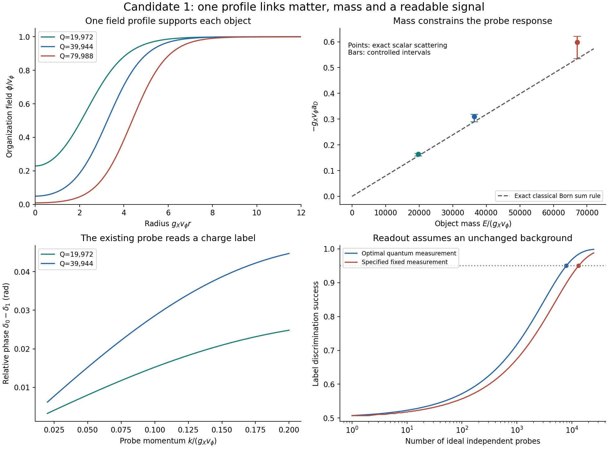

# GRUT: one explicit working model and its remaining inputs

22 October 2026 · constructive synthesis for Ryan Grover · parent 9249757

**The clearest present GRUT hypothesis is a closed quantum world with
interacting fields, where persistent objects are organized field states,
their physical states can carry records, and their energy and stress couple
to one shared spacetime metric.** Candidate 1 is the most developed explicit
realization in this program. It combines adopted Einstein gravity and
ordinary quantum matter with a specified additional scalar sector.

That is a concrete effective theory to calculate and test. It is not a
derivation of quantum theory, the Standard Model or spacetime from closure,
and the new scalar fields have not been detected. No calculation here fixes
the observed dark-energy density. The purpose of this synthesis is to make
the working hypothesis, its mechanism and the missing physics explicit.

## 1. The common action

Use the unchanged Candidate 1 action, in natural units and signature (-+++):

\[
\boxed{S=\int d^4x\sqrt{-g}\left[
\frac{M^2R}{2}-\rho_\Lambda+\mathcal L_{\rm SM+\nu_R}
-\frac12(\nabla\phi)^2-|\nabla X|^2
-\frac12(\nabla D)^2-U(\phi,X,D)\right]+S_{\rm boundary},}
\]
\[
U=\frac{\lambda_\phi}{4}(\phi^2-v_\phi^2)^2
+g_X^2\phi^2|X|^2+\lambda_X|X|^4
+\frac12(m_{D0}^2+h_D^2\phi^2)D^2+\frac{\lambda_D}{4}D^4.
\]

M is the reduced Planck mass. X is a complex charged field; phi is the real
field that changes its binding environment; D is a real probe field.
The global U(1)_X and two scalar sign symmetries are postulated. The SM block,
including the candidate's three right-handed neutrinos and Dirac-neutrino
choice, is supplied ordinary particle physics. The original EFT prescription
includes all allowed counterterms and their stated matching, rather than
claiming the displayed terms are closed under quantum corrections.

The original benchmark remains g_X=.1, lambda_phi=.01, lambda_X=.001,
h_D=.01, lambda_D=.001, m_D0=g_X*v_phi and v_phi/M=1e-5. Its additional
finite matching coefficients are not changed here. These are illustrative
model inputs, not numbers derived from GRUT or measured for a new sector.
The full action, gauge/constraint conventions and matching remain in the
[original specification](../grut_candidate_1_20261018/GRUT_CANDIDATE_1.md).

**Notation prevents a false unification:** v_phi is not the electroweak
Higgs scale v_H=246 GeV. Candidate 1's phi is not the inflaton of the later
vacuum proposals. The q four-form, the kinetic-pole remnant and this scalar
sector have not been identified as one field by any derivation.

## 2. What the mechanism actually does

There is a simple feedback loop in these equations. Populating X pushes
the magnitude of phi down. That lowers the g_X^2*phi^2 contribution to
the X energy, allowing charge to bind. Gradients and quartic repulsion
oppose indefinite compression. A stationary localized object can result.
Its existence uses a supplied conserved charge and an initial state;
the mechanism does not create a net conserved charge from vacuum.

The same phi profile then changes the local propagation coefficient of D,
m_D^2(r)=m_D0^2+h_D^2*phi(r)^2. A probe scatters from that organization.
The energy and stress of the very same solution source the adopted Einstein
equation,

\[
M^2G_{\mu\nu}+\rho_\Lambda g_{\mu\nu}=T_{\mu\nu}.
\]

Thus binding, probe response and weak gravity are compatible consequences
of one action. Gravity is supplied by the Einstein term; it is not generated
by renaming the scalar feedback. This is a quartic extension of the established
Friedberg–Lee–Sirlin soliton mechanism, with a specified probe interaction.

The quantum account is equally explicit at its EFT scope. A stated global
preparation evolves under the specified dynamics; subsystem descriptions
are restrictions of that state. Reduced evolution depends on the complement
and on correlations. In a regulated factorized setting,

\[
\rho_A=\operatorname{Tr}_{\bar A}\rho_\Omega,\qquad
\dot\rho_A=-i[H_A,\rho_A]
-i\operatorname{Tr}_{\bar A}[H_{A\bar A},\rho_\Omega].
\]

This implements the closed-whole organizing idea using ordinary quantum
mechanics. It does not choose H or the initial state. It does not force
every local process to relax, every environment to be thermal, or every
record to last. In cosmological gravity the conserved statement is the
covariant stress equation, not a universally defined constant global
energy. Full nonperturbative quantum gravity is outside this construction.

## 3. A new relation connecting the outputs

The new calculation keeps the action fixed and solves five integer-charge
backgrounds. It uncovers an exact identity for the classical flat-space
stationary solutions:

\[
\boxed{E_Q=\lambda_\phi v_\phi^2
\int[v_\phi^2-\phi_Q(\mathbf x)^2]d^3x.}
\]

The object's mass is proportional to its total depletion of the organization
field. This follows both from a fixed-charge scaling derivative and from
the integrated field equations plus the virial identity. The methods are
standard; no literature-first claim is made. Its recognition followed the
initial numerical pattern and is recorded in [the amendment](AMENDMENT_01.md).

Because the probe sees that same depletion, its leading short-range,
low-energy scattering length obeys

\[
\boxed{a_D^{\rm B}(Q)
=-\frac{h_D^2E_Q}{4\pi\lambda_\phi v_\phi^2}.}
\]

Here B denotes the first-Born approximation. Once the common couplings
and an object's mass are fixed, this leading probe response has no separate
adjustable profile parameter. Its gravitational monopole mass also equals
E_Q at the stated weak-field order. That is an explicit relationship between
different observations, rather than three unrelated fitted effects.

The exact scalar-potential scattering calculation gives a controlled
correction. For I=integral r|V_D|dr<1,
a_D^B/(1-I)<=a_D<=a_D^B<0. The new finite-charge results are:

| Prepared charge Q | E_Q/(g_X v_phi) | E_Q/(Q g_X v_phi) | Exact g_X v_phi a_D | I |
|---:|---:|---:|---:|---:|
| 19,972 | 19,729.91010 | 0.987879 | -0.16349977 | 0.055477 |
| 39,944 | 36,392.42286 | 0.911086 | -0.31048493 | 0.090398 |
| 79,988 | 67,089.45420 | 0.838744 | -0.59776062 | 0.140271 |

The leading formula differs from the exact lengths by 4.14%, 7.21% and
11.97% relative to its own magnitude; all lie inside the derived bounds.
The mass identity holds to about 2e-12 numerically on the refined profiles.
It is an exact **classical on-shell** relation, not an all-orders quantum
identity or a solution of the cosmological-constant problem.

The scattering length is defined for the short-range scalar matching
problem. Full gravity has a long-range tail; an actual measurement must
model or subtract its contribution. At the finite readout momenta the
estimated gravitational Coulomb parameter is below 1.35e-7, but its phase
correction is not computed here. Quantum corrections and extra matched
scales can also modify the relation. See [the derivation](MATHEMATICS.md).

## 4. Information can reside in the matter

The earlier probe-well calculation did not show a trapped linear D mode.
That does not require adding a separate memory field. A prepared object's
charge can label its state; a passing D wave can carry information about
that label to another subsystem. Storage and transmission have different
physical carriers in this example, both already in the action.

For Q=19,972 versus 39,944, the new calculation sends the same declared
finite momentum wavepacket in a superposition of two angular channels.
Their relative phase is a physical readout. A single monochromatic channel's
overall phase would carry no such distinguishing information.

The outgoing probe states have squared overlap .999790725574. An ideal
single probe distinguishes the two labels with maximum success .507233.
Under the ideal fixed-background repeated-probe assumption, the standard
quantum optimum reaches .95 at 7,935 probes. A specified fixed two-mode
measurement and exact binomial decision reach it at 13,270 probes.
These are calculated field-observable probabilities, not a built detector
or an experiment. Source, mode preparation, measurement and access are
supplied. Repeated-read recoil, excitation and cumulative disturbance are
not calculated. Global charge conservation alone does not prevent charge
from leaving a chosen object.

The same outgoing-state overlap controls dephasing of a compatible coherent
joint object/reservoir state. Readable information and loss of that joint
coherence therefore follow from the same interaction. The Born rule is
adopted, and no unique outcome or consciousness-dependent force is derived.
A complete physical observer would also need an actual writer, persistent
acquired records, readout hardware and feedback in one operating regime.
Subjective experience remains unexplained by this calculation.

## 5. Matter energy and vacuum energy are different obligations

A dilute cold population of these objects can be described at long distances
by worldlines with masses E(Q). For a conserved, well-separated population,
its mean rest-energy density scales approximately as a^-3. Emitted waves
can redshift as radiation. Neither component becomes a constant vacuum
density by being called a remnant or information.

The classical charge-energy lower bound remains valid after clumping:
rho_exc>=m_star|n_Q|. Its cosmological use still needs a charge yield,
an expansion history and a consistent *total* vacuum density. The existing
wall studies reject particular hot, memory-erasing histories and leave
conditional cold histories; they do not derive a unique preparation or
establish universal equivalence to cold dark matter.

The gravitational vacuum coefficient is a separate renormalized input of
the action. The original local benchmark matching rho_Lambda(mu0)=0 does
not set the sum of the counterterm and all matter vacuum contributions to
the observed positive value. This packet preserves that matching; it does
not quietly insert a replacement. A cosmological completion must derive
the total or state its calibrated value and its radiative limitations.
Calibrating it would permit a phenomenological model, but would leave its
smallness unexplained.

The later vacuum program sharpened this obligation:

| Construction | What the equations supply | What remains supplied or fails |
|---|---|---|
| Fixed-state q construction | Conserved equations and conditional constant cancellation | Selection of mu and a positive residual |
| Positive false phase | Classical accelerating solution | Its energy gap, occupation and lifetime |
| Dissipative q example | Radiation-compatible positive attractor | Finite-history relaxation is far too slow in the worked model |
| Inflation/kinetic-pole remnant | Conditional electroweak-scale target and an inflaton-to-wave channel | Required state preparation; the late pole barely repairs offsets |

These are distinct constructions. No accepted result combines them into
the displayed Candidate 1 action. Their source credits and limitations
remain in their own packets. The observed density has not been obtained
from the closed-whole principle or this new mass/readout relation.

## 6. What is resolved, and what still determines the theory

The model's content is now clear: a common action supports a worked family
of organized matter states; their structure determines both gravitational
and probe effects; a prepared matter label is readable through the existing
interaction; ordinary quantum evolution relates that readout to correlations.
The new finite-charge sum rule makes the connection quantitative. The old
graph, moving-word and spin-memory results are separate explorations,
rather than additional laws silently appended to this action.

Three unresolved requirements still limit the universal claim:

1. **An empirically selected law.** The additional fields and couplings need
   independent physical evidence. Recovering adopted Einstein or quantum
   equations is not that evidence. The mass/probe relation becomes a test
   only if the sector and its shared parameters can be independently accessed.
2. **A viable state and history.** Charge supply, population formation,
   entropy, thermal history and cosmological vacuum matching remain inputs
   or conditional calculations. The late pole is not a generic selector.
   A new selector must be an explicit physical rule with a viable basin
   and calculated consequences, not the observed answer written as a target.
3. **A common operating regime for records and observers.** The new result
   supplies passive encoding and ideal readout. Autonomous writing,
   controlled repeated use, lifetime and feedback must still coexist under
   the same dynamics. The separate M1 memory computation cannot fill this gap.

Deriving spacetime, particle content, quantum probabilities or the constants
would be further achievements beyond this effective theory. The existing
campaigns have not earned them. Closure organizes a model and constrains
its consistency; it has not selected a new universal law.

**The present working theory is therefore one specified covariant quantum
EFT with a concrete organization mechanism and linked conditional outputs.**
It is sufficiently explicit to make further calculations and expose a wrong
prediction. It remains a proposed physical model, with an unresolved
cosmological state and no empirical validation of its new sector.

## Evidence and reproduction

The new run passes 51 internal numerical conditions, with larger-domain and
tolerance controls, a raw-data verifier and fresh replay. These are internal
checks by one author. They do not validate the hypothetical fields.
[Protocol](PROTOCOL.md) · [mathematics](MATHEMATICS.md) ·
[status map](STATUS_MAP.md) · [sources](SOURCES.md) ·
[verification](VERIFICATION.md) · [reproduction](REPRODUCE.md).
