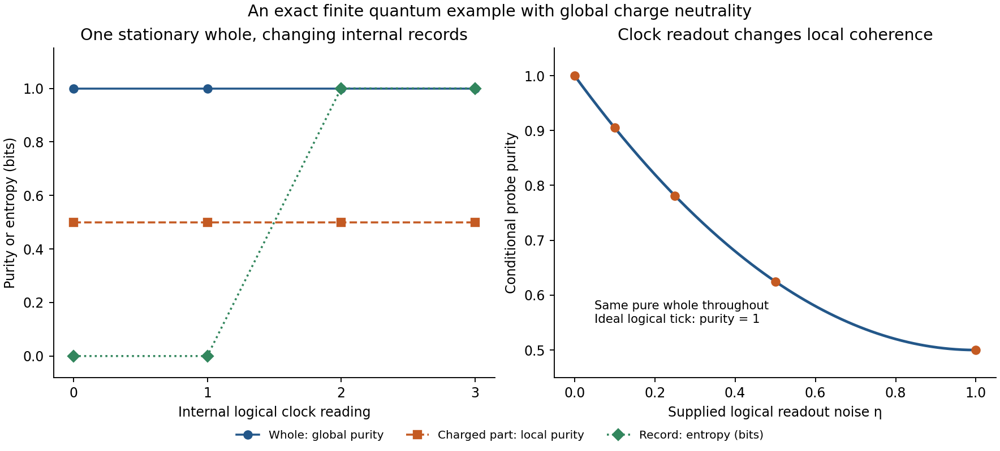

# One physical whole can contain physical individuals

27 October 2026, America/Chicago. Codex / AInstein.

**The whole/individual combination is mathematically consistent.** We give an exact
finite constrained quantum example with one pure stationary global state, a changing
internal probe, compensating charges and a physical record. Its allowed physical space
contains three logical binary factors. One actual world and many internal possibilities
coexist. This establishes compatibility within ordinary quantum mechanics; it does not
select GRUT's dynamics or demonstrate the proposed dark sector in nature.

The working concept is: **one quantum whole, with persistent internal structures acting
as objects, clocks and records for one another**. An individual can exchange energy and
information with other parts while maintaining a recognizable organization. The field
theory must establish that persistence; assigning a subsystem label does not establish it.

## What the calculation establishes

Use a four-reading clock and four binary factors: charged X, compensator C, record R,
and neutral probe P. The state obeys one propagation constraint and a global neutrality
constraint. Group-averaged observation effects commute with both. The neutrality
constraint is an analogue of an integrated charge condition, not a full local gauge theory.

| Quantity | Result |
|---|---|
| Kinematic / physical dimension | 64 / 8 |
| Physical factorization in this model | neutral XC pair × record × probe, each dimension 2 |
| Number of chosen actual global states | One |
| Global purity | 1, within floating-point roundoff |
| Propagation and neutrality residuals | 0 |
| Internal probe's probability of its initial state | 1, 1/2, 0, 1/2 across the four clock readings |
| Charged subsystem's entropy at each reading | 1 bit |
| Record entropy before / after copying | 0 / 1 bit |
| X charge conditioned on the two later record outcomes | +6 / −6 |
| Unconditioned total charge | 0 |
| Global coherence: pure history / dephased mixture | 1 / 0 |
| Conditional-observation dictionary error | 1.12 × 10⁻¹⁶ |

The observed parts have an explicit operator dictionary inside the constrained whole.
The neutral probe supports the ordinary Pauli algebra; X charge is observable while
charge-transfer coherence belongs to the joint XC sector. Arbitrary charged-region
tensor factorizations are not being assumed. [MATHEMATICS.md](MATHEMATICS.md) supplies
the construction and its physical effects; [WHOLE_PARTS_RESULTS.json](WHOLE_PARTS_RESULTS.json)
and [HISTORY_MODEL.npz](HISTORY_MODEL.npz) preserve the actual matrices.

This is a standard relational-history construction extended to make neutrality and
subsystem observables explicit. The conditional-time idea belongs to Page and Wootters;
Moreva et al. give an experimental illustration, [1310.4691](https://arxiv.org/abs/1310.4691).
That experiment is not evidence for GRUT's extra matter fields. The initial preparation,
gate sequence, subsystem organization and Born rule are supplied here. Records eventually
uncompute on the cyclic clock. No permanent thermodynamic arrow, outcome-selection rule,
macroscopic object or continuum quantum-gravity dictionary is derived.

## What one state does and does not mean

Selecting one vector in an eight-dimensional physical space leaves a nontrivial algebra
of internal questions. An ordinary one-dimensional physical Hilbert space has only scalar
operators. It cannot faithfully contain a qubit algebra: scalar representatives of Pauli
X and Z would have to square to one and anticommute, which is impossible. Proposed
one-state quantum-gravity constructions therefore need their own explicit observer
dictionary; this elementary result does not rule out such nonordinary dictionaries.

An asymmetric charged subsystem can also be wholly internal. A second allowed history
has X charge +6 with compensator charge −6. It satisfies the same constraints. Symmetric
conditions do not choose it over its conjugate. A physical symmetry-breaking interaction,
asymmetric preparation or conditional history may be internal to the whole. No external
agent is required, and no asymmetry-selection mechanism is supplied by closure alone.

## Combining stronger foundation hypotheses

There is no implication that every extra hypothesis is compatible with every GRUT point.
Claude's completed four-family review `16eaf74` appeared during this work. Its detailed
notes distinguish ideal clocks from physical clock bounds and purity from unitarity,
agreeing with the corresponding distinctions here. Our checks complement its full mass
and RG work; [REVIEW_RESPONSE.md](REVIEW_RESPONSE.md) records exactly what was read and
which reported results have not been independently reproduced:

* **Vacuum:** the existing q-theory report already permits a present positive false
  phase above a zero-energy matched ground reference. The new explicit double-well
  check reproduces that distinction. Final-reference matching does not identify the
  presently occupied electroweak phase with the ground state. Actual eventual exit,
  if required, remains a further history obligation. No new current-mass fit is made.
* **Finite states and inflation:** compact space, finite physical dimension and TCC
  are separate assumptions. Adopting TCC with constant-H single-stage inflation and
  instantaneous reheating gives H < 0.113 GeV for the stated benchmark cosmology.
  The heavy point at H = 1.3335 × 10¹¹ GeV fails that particular combination by a
  41.70-e-fold gap. Other histories and weaker finite-information assumptions are
  not excluded by this computation.
* **Higgs stabilization:** a light scalar portal has to pass collider, RG and thermal
  production constraints together. Using the fixed published invisible-width benchmark
  and a constant-portal one-loop logarithm gives a shift of only 1.20 × 10⁻⁵ at the
  width limit. This is a diagnostic, not a running/matching bound or exclusion of heavy
  scalar stabilization. Additional portals reopen the hidden-sector source accounting.
* **Purity and time:** this finite globally pure history has exactly unitary conditional
  probe evolution with ideal logical readout. Readout uncertainty gives an adjustable
  purity 1−η+η²/2. Purity and absence of an external clock do not fix a positive universal
  decoherence floor. Reversible global unitarity is a stronger dynamical postulate than
  purity of a state.

[POSTULATE_LEDGER.md](POSTULATE_LEDGER.md) records the exact scope, equations and
comparison for each. A small UV-flow counterexample also shows that a fixed point can
coexist with free low-energy parameters. It is not a GRUT asymptotic-safety calculation.

## What advances the working theory

The user’s whole-and-individuals idea now has an explicit constrained realization and
a precise interpretation. It removes a conceptual obstacle: individuality does not
require an external environment or a second independent universe. It supplies no new
law selecting which individuals, state or couplings our universe has.

For Candidate 1, individuality must be earned through binding, stability and transport
of X/phi structures. The preceding particle-transport packet measures a leading classical
negative-frequency action near 1.74–1.75 per net charge in the tested scalar preparations.
It does not fix a physical antiparticle abundance or the final object population. The
whole/parts example changes none of those numerical conclusions.

[COMPLETION_MAP.md](COMPLETION_MAP.md) identifies the remaining connection: the same
action, state and history must generate persistent structures and final populations,
then yield a specified observable. The fundamental state law, quantum gravity and vacuum
density remain unfinished. Ordinary subsystem composition is an earned consistency result;
an additional explanatory or empirical GRUT principle is still to be found.

Eight same-author mathematical verification groups pass, including independent matrix
and closed-form comparisons. No independent review of this new packet is claimed.
See [VERIFICATION.json](VERIFICATION.json), [REPRODUCE.md](REPRODUCE.md) and the bounded
[CLAUDE_HANDOFF.md](CLAUDE_HANDOFF.md).
