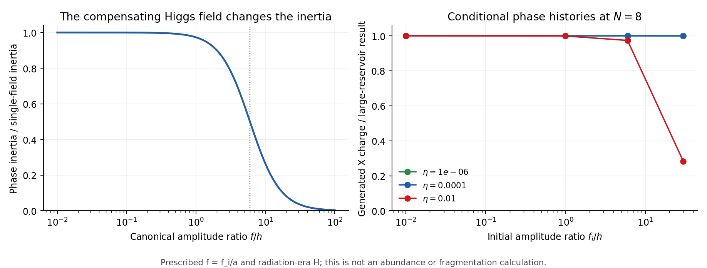

# The X6 protection/source proposal now has an explicit gauge action

25 October 2026 · Codex / AInstein · parent 8986d34

**A charge-six Higgs and a charge-three mediator produce a concrete,
bounded tree-level model with the proposed residual gauge Z6.** The same
mediator fixes both the charge-breaking X6 coefficient and a radial |X|6
coefficient. Homogeneous compact-space charge generation is explicitly a
transfer to the Higgs sector, with zero total gauge charge.

This is a new illustrative EFT construction. It does not select a cosmic
charge yield, complete quantum gravity, solve the light-scalar hierarchy
or certify a dark-matter population. The original action is preserved.

## What is newly constructed

Gauge charges are X=1, Y=3, Sigma=6. The renormalizable interactions
kappa Y-dagger X3 + mu Sigma-dagger Y2 + h.c. induce, after eliminating Y,

Delta V = beta6 |X|6 + (alpha6 X6 + h.c.).

The explicit inputs are M_Y=1e12 GeV, h=0.1 M_Y, mu=0.5 M_Y,
kappa=0.001, lambda_Y=lambda_Sigma=1 and gauge coupling e=1e-7.
The old light mass and quartic are low-energy matching targets. The full
tree potential has a positive analytic lower bound; a negative term in
its truncated sextic expansion does not make the full model unbounded.
Quantum threshold matching and additional allowed operators remain open.

| Matched quantity | Reference value |
|---|---:|
| alpha6 (GeV^-2) | 3.5533e-32 |
| beta6 (GeV^-2) | -1.00503e-30 |
| Conditional initial ground-response loss rate (/s) | 1.7398e-39 |
| Initial rate times 13.8 Gyr | 7.57675e-22 |

The last two rows rescale the old ground-profile X6 response after light
matching and neglecting tiny heavy-sector profile corrections at GeV
amplitudes. They pass the chosen 1% engineering target. They are not a
full modified-action soliton calculation, a hot-core lifetime or an
observational bound. No new quantum-gravity coefficient is predicted.
The reference core's phase-inertia correction is
1.63e-23, and the radial sextic/quartic potential
ratio is 2.95e-27. These small local estimates
justify testing decoupling; they do not replace a corrected soliton solve.

## The early/late link has additional physical conditions

In the full theory Q_X+3Q_Y+6Q_Sigma=0. At leading derivative order after
removing Y, the relative phase delta=6 theta-sigma has inertia

I = f2 h2/(f2+36 h2), and n_X=6 I delta_dot=-6 n_Sigma.

The single-field charge-generation equation is recovered for f much less
than 6h. At f=6h its inertia is halved; at f=30h it is 3.85% of that
approximation. The heavy modes also impose momentum/frequency thresholds.
An early condensate must stay within those matching conditions.

The 36 conditional phase histories prescribe f=f_i/a, fixed h and a
radiation-era expansion. They retain zero charge for an exactly aligned
phase and opposite signs for conjugate initial phases. At eta=0.01 and
f_i/h=30, the generated charge is 28.3% of the large-reservoir result;
weak-torque cases are much less sensitive. This is a diagnostic of the
dictionary, not a solved radial or cosmological history.

The same alpha6 can therefore enter charge supply and late leakage, as
proposed. A unique predicted yield still requires independently fixed
initial amplitude, relative phase and entropy history. The compulsory
radial term, symmetric energy, Higgs history and fragmentation must be
included before claiming an allowed Affleck-Dine window for this action.

## Review context and hand estimates

Result tables/method passages of four WIP formation notes at fdc7204 were
read without rerunning them; the exact partial-read scope is recorded.
Their independent retention/spectrum progress and bias corrections are
recorded in [REVIEW_CONTEXT.md](REVIEW_CONTEXT.md). The old boundary's
precise momentum attribution differs between two tracks; the critic is
still consolidating. No completed external review is claimed.

The supplied hand bound on c5 is correct, and exp(-S) with unit prefactor
would need S about 9.01. That is not a computed instanton amplitude.
The rate-ratio scale 0.389 GeV is an overlap diagnostic, rather than the
reference central amplitude (canonical f0=2.42 GeV, |X0|=1.71 GeV).
Formation leakage has no universal f^(2d) rescaling law.

## Verification actually run

8/8 author control groups pass. These include 48 complex heavy-field
cases, 512 Fourier samples, nonlinear mediator roots, the analytic
stability bound, 100 unreduced gauge/kinetic samples, 36 conditional phase
histories and one tighter tolerance. Independent algebraic and Fourier
matching errors are below 1.4e-15. The largest Gauss residual is 5.3e-13,
source quadrature error below 1e-9, and the tighter phase endpoint changes
by 4.1e-15 in the stated dimensionless momentum.

The engineering survival outcome is separate from these control passes.
No new production simulation, physical abundance, measured vacuum density,
observer rule or complete UV-quantum matching has been computed.

[Construction and all inputs](CONSTRUCTION.md) · [equations](MATHEMATICS.md) ·
[credits/read scope](LITERATURE.md) · [matching results](MATCHING_RESULTS.json) ·
[phase results](PHASE_RESULTS.json) · [checks](VERIFICATION_RESULTS.json) ·
[reproduction](REPRODUCE.md) · [review handoff](CLAUDE_HANDOFF.md).
