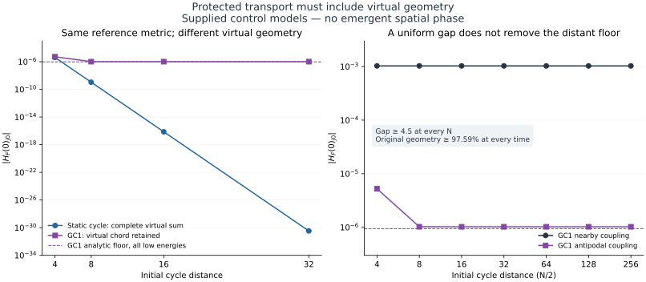

# GRUT Path B: protected transport and virtual geometry

Research base: `678e934367ead8e03cb51e39dd078ca3dc265cae`.

This packet constructs a separately named **GRUT-WM1** walk mediator,
solves its static-geometry transport module exactly, and calculates the
virtual geometry obstruction. The static module has a derived gap,
exponential matrix-element bounds at all orders, localized dressing and
nonzero nearby transport. A full coupled spatial phase remains unproved.

The independent GC1 control has a uniform gap and persistent initial
geometry but a nonzero distant Schur-coupling floor at increasing cycle
distance. Exact full-law words also show a surviving WM1 activation
process in the unchanged CP-12 geometry dynamics. The two claims have
different scopes and are never conflated.

Read [REPORT.md](REPORT.md), [MODEL.md](MODEL.md),
[MATHEMATICS.md](MATHEMATICS.md) and [HANDOFF.md](HANDOFF.md).
[PROTOCOL.md](PROTOCOL.md) defines the calculation gates and supplied
parameters. [SOURCES.md](SOURCES.md) credits established methods and
separates this work from a new prediction about nature.



From the repository root:

```sh
python research/reality_framework/path_b_protected_transport_20261016/reproduce.py
python research/reality_framework/path_b_protected_transport_20261016/reproduce.py --full
```

The default verifies saved results, derivation constants, frozen inputs
and the content manifest. `--full` regenerates all controls and their
independent exact full-H checks. Requirements are Python, NumPy, SciPy
and Matplotlib; no external datasets, compiler or inherited numerical
cache is needed. RESULTS.json supplies raw data, ASSESSMENT.json the
claim gates, and VERIFICATION.json the consistency record. The content
manifest excludes itself and VERIFICATION.json to avoid circular hashes.

Exact rational word checks and analytic bounds are distinct from
ordinary floating-point matrix checks. No numerical pass constitutes
a verified physical phase, universal locality or external peer review.
CP-12, canonical GRUT-RAI, Stage3, PR12 and SCOUT-1 remain unchanged.
