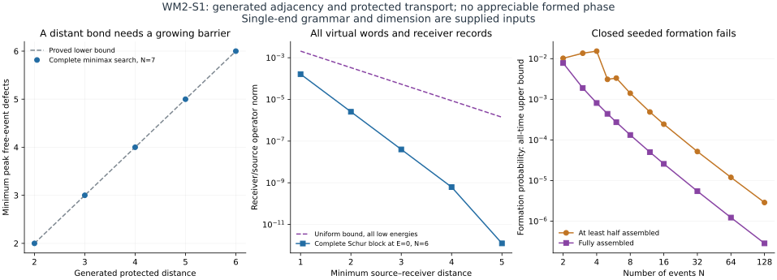

# WM2-S1: end-defect assembly and protected operational transport

WM1 reference: `8741b6e74d571e643e9208187f5d93b5a8e2471c`.

This separate WM2 construction generates labeled event adjacency through
finite-support, permutation-covariant head moves. It proves a virtual
word-length barrier and complete distance-weighted transport bound,
including coherent geometry packets and all receiver records. The
closed seeded candidate **fails appreciable formation at every time**;
its one-dimensional grammar is also supplied. Full WM2 remains open.

Read [REPORT.md](REPORT.md), [MODEL.md](MODEL.md),
[MATHEMATICS.md](MATHEMATICS.md) and [HANDOFF.md](HANDOFF.md).
[CHARTER.md](CHARTER.md) preserves the user's metric-generation and
protection gates. [EXACT_CONFIGURATION.json](EXACT_CONFIGURATION.json)
records finite-register, complete word and minimax barrier checks;
[RESULTS.json](RESULTS.json) supplies every finite matrix and formation
control. [SOURCES.md](SOURCES.md) distinguishes standard methods and
project-specific constructions from a new empirical prediction.



From the repository root:

```sh
python research/reality_framework/wm2_defect_assembly_20261016/reproduce.py
python research/reality_framework/wm2_defect_assembly_20261016/reproduce.py --full
```

The default checks saved evidence, source hashes and scope. `--full`
regenerates exact configuration tests before the small numerical work,
report and figure. Requirements are Python, NumPy, SciPy and Matplotlib.
No compiler, external dataset, giant inherited cache or electric-state
regulator is needed. Finite matrix checks use ordinary floating point;
the all-N claims have explicit analytic proofs and are not inferred
from the finite-size samples. Manifest and verification self-hashes are
excluded to avoid circularity.

Canonical GRUT-RAI, Stage3, PR12, CP-12, WM1 and SCOUT-1 are unchanged.
